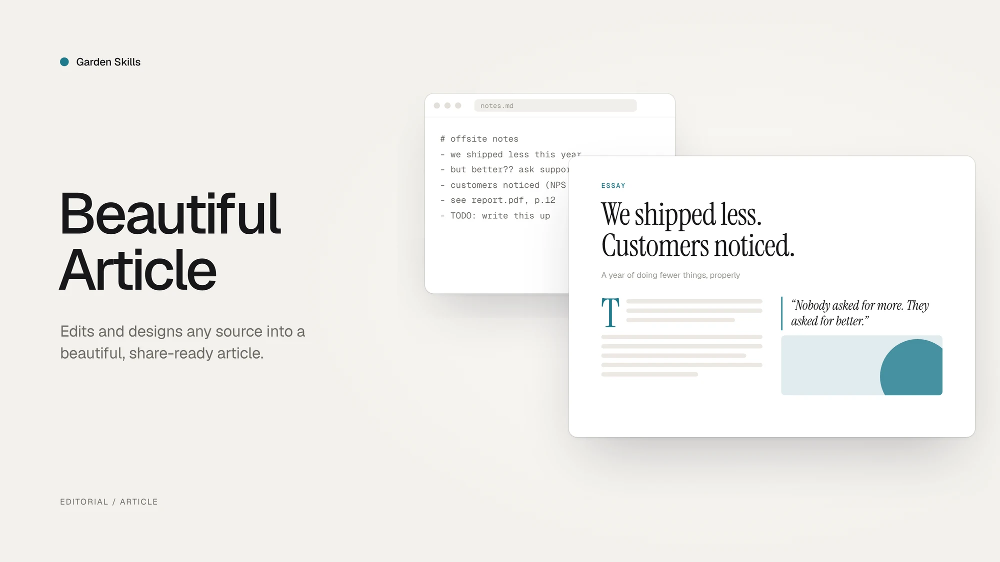

# Beautiful Article Skill — Turn any source into a beautiful article

> A skill for AI agents to **edit and design** any source material (URL / PDF / DOCX / Markdown / plain text / screenshots / pasted notes) into a **beautiful, share-ready article** that is easier to read, archive, and pass around than the original.

[中文文档](./README.zh-CN.md) · [Back to collection root](../../README.md)



---

### Powered by [ReActicle](https://github.com/ConardLi/reacticle)

`beautiful-article` is the editorial **harness** (methodology, checkpoints, theme picker, sub-agent reviewers); [`reacticle`](https://github.com/ConardLi/reacticle) is the underlying **runtime component protocol** the skill writes against — prose-first React components plus a token-based `Raw` escape hatch, all wired into the same theme system.

```
beautiful-article  (this skill · methodology + harness)
        │  composes
        ▼
reacticle          (npm package · components / themes / Raw / export)
```

| Layer | What it owns | Where it lives |
|---|---|---|
| `beautiful-article` (this skill) | **How** the agent plans, writes, reviews and delivers an article from any source — six numbered phases, three hard checkpoints, theme picker, sub-agent reviewers | This directory |
| `reacticle` | The component vocabulary + 11 authoring themes the skill compiles into — `Article` / `Hero` / `Lead` / `Section` / `Quote` / `Image` / `Formula` / `CodeBlock` / `Raw` …, each theme a `.css` token bundle + `.md` authoring profile | [`ConardLi/reacticle`](https://github.com/ConardLi/reacticle) · [npm `reacticle`](https://www.npmjs.com/package/reacticle) · [docs](https://rearticle.mmh1.top/) |

The two pair very well but are independently useful: the skill works because it has ReActicle to target, and ReActicle is a perfectly usable React library on its own.

---

### [Showcase](https://mmh1.top/#/ai-article) — articles built with `beautiful-article` + ReActicle

Real long-form articles, each authored end-to-end by an AI agent running this skill against the [`reacticle`](https://www.npmjs.com/package/reacticle) component protocol. Click any cover to open the live, single-file HTML article.

<table>
<tr>
<td width="50%" valign="top" align="center">
<a href="https://mmh1.top/#/ai-article/tools">

<br><b>Agent Tools 设计的最佳实践</b>
</a>
<br><sub>Theme · Freddie · 长文 · 21 min</sub>
<br><sup>Anthropic 工程团队关于 Tools 的五条原则，与一套评测驱动的方法。</sup>
</td>
<td width="50%" valign="top" align="center">
<a href="https://mmh1.top/#/ai-article/skill">

<br><b>Agent Skill 是如何进化的？</b>
</a>
<br><sub>Theme · Freddie · 解释文 · 8 min</sub>
<br><sup>把 Skill 文档当成被训练的对象，而不是被复制粘贴的 prompt。</sup>
</td>
</tr>
<tr>
<td width="50%" valign="top" align="center">
<a href="https://mmh1.top/#/ai-article/harness">

<br><b>Agent Harness 的解剖图</b>
</a>
<br><sub>Theme · Vignelli · 长文 · 12 min</sub>
<br><sup>智能在模型里；让智能变得有用的，是它周围的那套系统。</sup>
</td>
<td width="50%" valign="top" align="center">
<a href="https://mmh1.top/#/ai-article/prompt-cache">

<br><b>提示词缓存对 Agent 有多重要？</b>
</a>
<br><sub>Theme · Bayer · 长文 · 15 min</sub>
<br><sup>缓存命中率是 Agent 的 SLO，Claude Code 团队的反直觉经验。</sup>
</td>
</tr>
<tr>
<td width="50%" valign="top" align="center">
<a href="https://mmh1.top/#/ai-article/context">

<br><b>面向 Agent 的高效上下文工程</b>
</a>
<br><sub>Theme · Tufte · 长文 · 16 min</sub>
<br><sup>本文探讨如何高效地筛选与管理驱动 AI Agent 运转的上下文。</sup>
</td>
<td width="50%" valign="top" align="center">
<a href="https://mmh1.top/#/ai-article/transformer">

<br><b>Attention Is All You Need</b>
</a>
<br><sub>Theme · Tufte · 长文 · 30 min</sub>
<br><sup>一篇重塑现代 AI 的论文，逐层拆给你看。</sup>
</td>
</tr>
<tr>
<td width="50%" valign="top" align="center">
<a href="https://mmh1.top/#/ai-article/agent-eval">

<br><b>把 AI Agent 的评测讲清楚</b>
</a>
<br><sub>Theme · Tufte · 长文 · 25 min</sub>
<br><sup>让 Agent 有用的那些能力，恰恰让它难以评测 — 来自 Anthropic 的指南。</sup>
</td>
<td width="50%" valign="top" align="center">
<a href="https://mmh1.top/#/ai-article/agent-loop-codex">

<br><b>Codex 的 Agent Loop 是怎么做的？</b>
</a>
<br><sub>Theme · Sottsass · 长文 · 18 min</sub>
<br><sup>OpenAI 官方分享：在 Responses API 之上，一条对话是如何被反复"展开"的。</sup>
</td>
</tr>
</table>

---

### [Theme Gallery](https://rearticle.mmh1.top/#/gallery) — one specimen article per theme

> 11 themes shipped. Full theme contracts (`.css` token bundle + `.md` authoring profile, anti-patterns, code/media style) are documented at [Theming](https://rearticle.mmh1.top/#/theming).

Every theme ships with a long-form **specimen article** that lives the theme end-to-end — typography, photography, code, formulas, Raw blocks, the works. Click any cover to read the live article; click the theme name to jump to that theme's section in the docs.

<table>
<tr>
<td width="33%" valign="top" align="center">
<a href="https://rearticle.mmh1.top/#/gallery/caffeine-half-life">

<br><b>Tufte</b> · Data-Ink
</a>
<br><sub>咖啡因与睡眠 · 数据笔记</sub>
<br><sup>Edward Tufte 数据墨水，证据优先，发丝级图表与最朴素的版式。</sup>
</td>
<td width="33%" valign="top" align="center">
<a href="https://rearticle.mmh1.top/#/gallery/movable-type">

<br><b>Press</b> · 书卷
</a>
<br><sub>活字之后 · 随笔</sub>
<br><sup>Stripe Press 式书卷长读物：会落定的标题、氧化血红首字母、纯正文之美。</sup>
</td>
<td width="33%" valign="top" align="center">
<a href="https://rearticle.mmh1.top/#/gallery/pool-exhaustion">

<br><b>Shannon</b> · 工程暗色
</a>
<br><sub>连接池耗尽 · 故障复盘</sub>
<br><sup>贝尔实验室技术论文血统，暗底黄金信号、回压依赖、夜间作战气质。</sup>
</td>
</tr>
<tr>
<td width="33%" valign="top" align="center">
<a href="https://rearticle.mmh1.top/#/gallery/orbit-spec">

<br><b>Vignelli</b> · 瑞士网格
</a>
<br><sub>Orbit 设计系统规格 · 规格</sub>
<br><sup>Massimo Vignelli 网格至上、grotesque 字族、瑞士红只承载结构。</sup>
</td>
<td width="33%" valign="top" align="center">
<a href="https://rearticle.mmh1.top/#/gallery/linear-attention">

<br><b>Knuth</b> · 学术
</a>
<br><sub>线性化自注意力 · 预印本</sub>
<br><sup>Donald Knuth / Computer Modern，编号小节、命题与证明、arXiv 草稿气质。</sup>
</td>
<td width="33%" valign="top" align="center">
<a href="https://rearticle.mmh1.top/#/gallery/first-newsletter">

<br><b>Freddie</b> · 暖黄
</a>
<br><sub>第一封 Newsletter · 上手指南</sub>
<br><sup>Mailchimp Freddie 黑字荧光，亲和插画 + 不端着的产品上手语气。</sup>
</td>
</tr>
<tr>
<td width="33%" valign="top" align="center">
<a href="https://rearticle.mmh1.top/#/gallery/slow-breathing">

<br><b>Andy</b> · 静谧
</a>
<br><sub>把呼吸放慢 · 练习</sub>
<br><sup>柔软圆润、呼吸-神经跷跷板，让人慢下来的练习气质。</sup>
</td>
<td width="33%" valign="top" align="center">
<a href="https://rearticle.mmh1.top/#/gallery/front-page">

<br><b>Bodoni</b> · 报刊
</a>
<br><sub>头版的消亡 · 特稿</sub>
<br><sup>高对比 Didone 报刊气质，黑白大报、对折线之上的分量。</sup>
</td>
<td width="33%" valign="top" align="center">
<a href="https://rearticle.mmh1.top/#/gallery/geometry-of-meaning">

<br><b>Bayer</b> · 包豪斯
</a>
<br><sub>形、色、网格 · 教学</sub>
<br><sup>Herbert Bayer 包豪斯三原色几何，形有性格、色有重量。</sup>
</td>
</tr>
<tr>
<td width="33%" valign="top" align="center">
<a href="https://rearticle.mmh1.top/#/gallery/rate-limiter-spec">

<br><b>Fuller</b> · 蓝图
</a>
<br><sub>限流器设计规格 · 系统设计</sub>
<br><sup>Buckminster Fuller 工程蓝图，方格纸拓扑、令牌桶模拟，可照着实现。</sup>
</td>
<td width="33%" valign="top" align="center">
<a href="https://rearticle.mmh1.top/#/gallery/color-clash">

<br><b>Sottsass</b> · 孟菲斯
</a>
<br><sub>撞色不翻车 · 设计随笔</sub>
<br><sup>Memphis 80s 撞色，黑描边、硬投影、轻微旋转的不正经语法。</sup>
</td>
<td width="33%" valign="top" align="center">
&nbsp;
</td>
</tr>
</table>

> Browse all specimens with theme switching, search and filters at the live gallery: <https://rearticle.mmh1.top/#/gallery>.

---

## What it does

`beautiful-article` turns dry, linear, hard-to-digest source material into a polished, visually clear, share-ready article. It is **not** a web-app builder — the focus is always the *article*: better reading, better pacing, better aesthetics. The article is delivered as a self-contained file that opens offline (with optional companion PDF), but that's a delivery detail, not the goal.

It is designed for:

- Repackaging long URLs / PDFs / DOCX / Markdown into a beautiful HTML long-form
- Producing briefings, explainers, tutorials, post-mortems, design / proposal reviews
- Visual essays, dialogue / interview transcripts, interactive learning explainers
- Any time you want a **better reading medium** than raw Markdown — with tables, SVG, code, formulas, copy / export buttons baked in

The skill is primarily a **methodology + collaboration harness**. It ships a Vite + React + TypeScript scaffold built around the [`reacticle`](https://www.npmjs.com/package/reacticle) component protocol — the agent does not hand-write naked HTML / CSS, it composes prose-first semantic components plus a theme-constrained `Raw` free layer.

---

## Core ideas

- **Article first, not app** — the focus is the article. Raw layers, SVGs, mini-tools must serve reading / explanation / pacing / aesthetics, not stand on their own.
- **Source → Plan → Build → Review harness** — every project flows through six numbered phases with three hard checkpoints in between.
- **Component protocol via `reacticle`** — semantic prose components (Hero, Lead, Section, Quote, Callout, Image, Formula, CodeBlock, Table, …) plus a `Raw` escape hatch that must use theme tokens (`--ra-*`).
- **Theme-driven design** — pick from a registry of authoring profiles (`tufte`, `press`, `bayer`, `bodoni`, `vignelli`, `sottsass`, `freddie`, `andy`, `fuller`, `knuth`, `shannon`) — each profile is a Markdown contract for the agent, not a CSS file.
- **100% information retention by default** — the article type carries a recommended retention ratio (longform `~100%`, briefing `~50%`, visual-essay `~40%`, …) which the user can override.
- **Hard collaboration checkpoints** — the agent pauses for the plan, the first-spread proof, and the final delivery decision; **every decision must be confirmed item-by-item, never silently bundled**.
- **Cover by default** — a 3:4 book-style cover sits above the TOC, locked container, theme-token only, no remote images.
- **Optional PDF export** — the main deliverable is a self-contained HTML file; PDF is opt-in via a zero-npm `html-to-pdf.sh` headless-browser script.

---

## Workflow

```text
Phase 0  Intake
   │
Phase 1  Source → Markdown      (URL / PDF / DOCX / MD / text → source.md)
   │
Phase 2  Editorial Planning     (one plan.md: Brief / Outline / Theme / Assets)
   │
★ Checkpoint 1  Plan            (5 independent decisions confirmed)
   │
Phase 4  First Spread           (cover + hero + first section + one signature visual)
   │
★ Checkpoint 2  First Spread    (acceptance + dev mode A/B)
   │
Phase 5  Full Article Build     (single-agent sequential or multi-agent parallel)
   │
Phase 6  Final Review           (Editorial / Visual / Technical)
   │
Phase 7  Repair                 (minimal-slice fixes only)
   │
★ Checkpoint 3  Delivery        (HTML, or HTML + PDF, or pause to revise)
   │
Phase 8  Delivery               (article.html, optional article.pdf)
```

The agent owns a per-project workspace directory that is its **long-term memory**:

```text
<workspace>/
  source/   original.*   source.md   source.<lang>.md (if translated)   extraction-notes.md
  plan/     plan.md
  article/  Cover.tsx   Article.tsx   sections/   raw-blocks/   assets/   article.html (output)
  review/   first-spread-review.md   final-review.md
            (source-review.md only on complex sources, repair-log.md only when there are repairs)
  index.html  package.json  vite.config.ts  tsconfig*.json  (build harness)
```

---

## Skill structure

```text
skills/beautiful-article/
├── SKILL.md                            Main skill (frontmatter name: beautiful-article)
├── manifest.json                       Release manifest
├── README.md  /  README.zh-CN.md       This document
├── references/
│   ├── article-types.md                Article-type router
│   ├── article-types/                  briefing / dialogue / essay / explainer / full-report
│   │                                    interactive-explainer / longform / review / tutorial / visual-essay
│   ├── information-density.md          Retention ratios vs. component / visual mix
│   ├── plan-template.md                Single plan.md template (Brief / Outline / Theme / Assets)
│   ├── theme-selection.md              Theme picker, density / theme decoupling rules
│   ├── layout.md                       Width modes, TOC defaults
│   ├── cover.md                        3:4 book-style cover guide (5 self-checks, 5 layouts)
│   ├── asset-policy.md                 Image strategy (none / user-assets / placeholders / ai-generated)
│   ├── component-policy.md             Reacticle component contract, prose-first
│   ├── raw-policy.md                   Raw allow / deny list, token-driven, self-checks
│   ├── section-build.md                One-section-one-file rule, sub-agent prompt templates
│   ├── source-to-markdown.md           Per-format extraction rules + 5-item self-check
│   ├── scaffold.md                     Scaffold script behaviour, workspace layout
│   ├── html-output.md                  dev / build / single-file commands
│   ├── pdf-output.md                   html-to-pdf.sh usage + print CSS overrides
│   ├── review-checklist.md             Per-phase reviewer checklists & sub-agent prompts
│   ├── repair-policy.md                Minimal-slice repair table
│   └── harness.md                      Skill-as-harness perspective
├── theme-profiles/
│   ├── index.json                      Theme registry
│   └── andy / bayer / bodoni / freddie / fuller / knuth / press / shannon / sottsass / tufte / vignelli
├── scripts/
│   ├── scaffold.sh                     One-shot workspace bootstrap
│   ├── html-to-pdf.sh                  Optional HTML → PDF (headless browser, zero npm deps)
│   ├── pdf-print-overrides.css         @media print overrides injected into the HTML
│   ├── source-to-markdown-markitdown.py  Main extraction path (PDF / DOCX / HTML)
│   └── source-to-markdown.py           Lightweight fallback (Markdown / TXT / simple HTML)
└── assets/
    └── scaffold-template/              Vite + React + TS template the scaffold script copies
```

---

## How it works (highlights)

### 1. Quality protocol per node

Different phases use different quality-checking approaches — over-using sub-agents and over-writing review files is the #1 perf trap, so the skill makes the rules explicit:

| Node | How it's checked | Artifact |
|---|---|---|
| Phase 1 Source (default) | Main agent inline 5-item checklist | none |
| Phase 1 Source (complex / low-confidence only) | Source Reviewer SubAgent (diff against `original.*`) | `review/source-review.md` |
| Phase 2 Plan / before Checkpoint 1 | **Main agent inline self-check (no SubAgent, no file)** | none |
| Phase 4 First Spread / before Checkpoint 2 | First Spread Reviewer SubAgent | `review/first-spread-review.md` |
| Phase 5 Per Section | Section Reviewer SubAgent — returns pass/fail by message | none (no per-section files) |
| Phase 6 Final / before Checkpoint 3 | Editorial + Visual + Technical Reviewer SubAgents | `review/final-review.md` |

### 2. No silent default decisions

At every checkpoint each decision is asked **independently** — the agent may recommend, but never sneak through "I went ahead with X, tell me if it's wrong". Five independent decisions on Plan Checkpoint: article type (with recommended retention), theme, width, image mode, cover on/off.

### 3. Article type → retention bundles

The 10 article types all carry a recommended retention ratio: `longform · ~100%`, `tutorial · ~90%`, `full-report · ~80%`, `explainer · ~80%`, `dialogue · ~80%`, `review · ~70%`, `essay · ~70%`, `briefing · ~50%`, `visual-essay · ~40%`, `interactive-explainer · ~25% excerpt + 75% AI-rebuild`. Users can override with a single sentence.

### 4. One-section-one-file rule

Every Section is its own component file in `article/sections/NN-*.tsx`. `Article.tsx` is just the assembler — owned by the main agent, who imports & orders sections, runs typecheck / build, and resolves theme drift. This is the precondition for sub-agent parallelism in dev-mode B.

### 5. Theme tokens everywhere

`Raw` blocks must consume `--ra-*` theme tokens — no wild colors / fonts. Switching theme rewires every Raw block in one place. Each theme ships a Markdown authoring profile telling the agent how to write & style content under that theme.

---

## Setting up a project

This skill **does not pre-create** a workspace — every project gets its own. From the SKILL's Phase 4:

```bash
# Default: cover on
bash <path-to-skill>/scripts/scaffold.sh ./my-article --theme=tufte

# Cover off
bash <path-to-skill>/scripts/scaffold.sh ./my-article --theme=press --no-cover

# List available themes
bash <path-to-skill>/scripts/scaffold.sh --list-themes
```

The scaffold spins up a Vite + React + TS workspace, installs the latest published `reacticle` from npm, and seeds `source/ plan/ review/` plus `article/Article.tsx`, `article/Cover.tsx`, and `article/sections/01-opening.tsx` so the agent has a known starting shape.

After Phase 5 the agent runs the build to produce a single inlined HTML:

```bash
npm run build           # → article/article.html (CSS + JS inlined)
```

Optional PDF export (only if Checkpoint 3 selects HTML + PDF):

```bash
bash <path-to-skill>/scripts/html-to-pdf.sh
```

---

## Best practices

### Recommended

1. **Pick the article type before anything else** — its retention ratio anchors the whole plan.
2. **Trust the harness phases** — don't skip Plan checkpoint just because you can guess the answer.
3. **Use theme tokens for every Raw block** — `--ra-*` only. No raw hex / font names.
4. **One section per file** — even if a section is small, isolate it. It pays off in review and repair.
5. **Cover should reflect theme + article gist** — not just a placeholder gradient.

### Avoid

1. ❌ Treating the skill as "make me an HTML page" — the deliverable is an *article*.
2. ❌ Bundling multiple checkpoint decisions into one yes/no.
3. ❌ Letting Raw blocks bring their own colors / typography (theme drift).
4. ❌ Writing all sections inside `Article.tsx` (kills sub-agent parallelism).
5. ❌ Removing the colophon / cover container (they are part of the contract).

---

## FAQ

**Q1: When should I *not* use this skill?**
When the user actually wants a web app, dashboard, form, prototype, or generic landing page — those go to `web-design-engineer`, not here. If in doubt, the skill stops and asks rather than silently producing the wrong artifact.

**Q2: Does it always produce 100% information retention?**
No — that is just the `longform` default. The article type sets the ratio, and the user can override at Checkpoint 1.

**Q3: Can the article be in a different language than the source?**
Yes. If the user specifies a target language different from the source, Phase 1 produces an idiomatic translation `source/source.<lang>.md` first, and Phase 2+ writes from that file.

**Q4: What if my agent runtime has no SubAgent / Task tool?**
The skill notes this case explicitly: the main agent backfills the SubAgent's job and writes "no SubAgent environment, main-agent fallback" at the top of the resulting review file.

**Q5: Why React + Vite + reacticle instead of plain HTML?**
Because the agent needs a stable, prose-first component contract that survives multi-section parallel work, theme switching, and Raw escape hatches. The `npm run build` step always inlines everything back into a single HTML for delivery.

---

## Tool requirements

The skill assumes the agent runtime can:

- Spawn shell commands (for `scaffold.sh`, `html-to-pdf.sh`, `npm` builds)
- Read / write files in a project workspace
- (Optionally) launch sub-agents for First Spread / Section / Final review nodes
- (Optionally) run `MarkItDown` (Python) for high-fidelity PDF / DOCX / HTML extraction; otherwise the lightweight fallback script handles Markdown / TXT / simple HTML

---

## License

MIT
