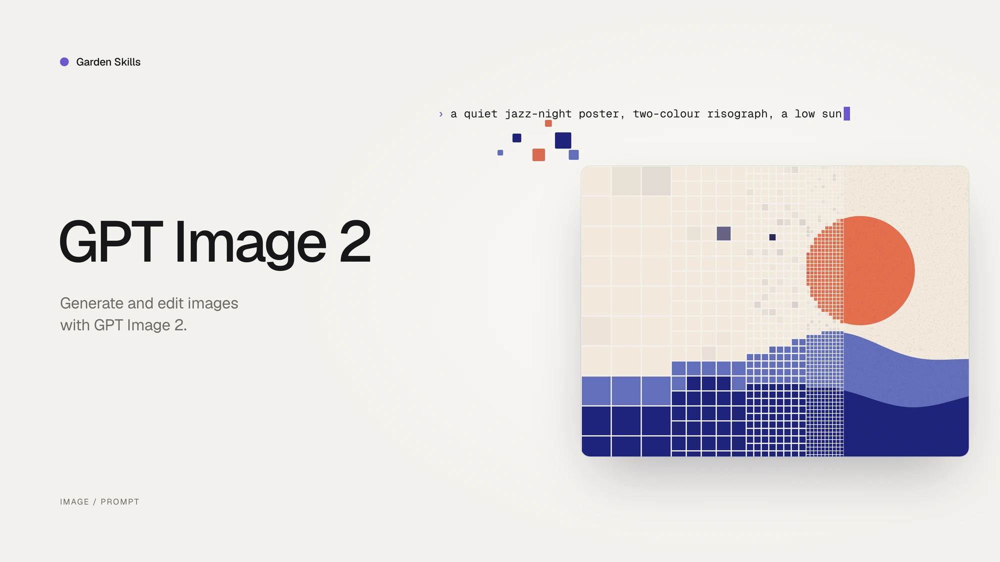

# GPT Image 2 Skill

**A focused image-generation / editing skill for GPT Image 2, with a single SKILL definition that adapts to three runtime modes — local generation, host-native delegation, and pure prompt advisor.**

[中文文档](./README.zh-CN.md) · [Back to collection root](../../README.md)



---

## What it does

This skill is a structured prompt-engineering and image-generation pack built around the GPT Image 2 model (and OpenAI-compatible image endpoints). It only does two image tasks — `POST /images/generations` and `POST /images/edits` — but it does them in three different runtime environments without changing user-facing behavior.

It bundles:

- A **mode-aware workflow** so the same skill works whether the agent itself owns the image API key, the host has its own image tool, or there is no image tool at all.
- A **structured template library** of 18 categories and 79 prompt templates covering posters, UI mockups, product visuals, infographics, academic figures, technical diagrams, comics, avatars, and editing workflows.
- **Reproducible prompt + image archival** under `garden-gpt-image-2/prompt/` and `garden-gpt-image-2/image/` with task-slug + timestamp naming.

---

## The three runtime modes

The very first thing this skill does on any task is run a tiny detection script:

```bash
node skills/gpt-image-2/scripts/check-mode.js
# or for structured output:
node skills/gpt-image-2/scripts/check-mode.js --json
```

The output picks one of three modes:

| Mode | Trigger | Behavior |
|---|---|---|
| **A — Garden local** | `ENABLE_GARDEN_IMAGEGEN` truthy **AND** `OPENAI_API_KEY` present | End-to-end: pick template → render prompt → call `generate.js` / `edit.js` → image lands on disk |
| **B — Host-native** | Garden disabled, but the host agent already has an image tool (`image_generation`, `dalle`, `nano_banana`, image MCP, etc.) | Render the prompt, then **delegate** image generation to the host's own tool |
| **C — Advisor** | Garden disabled, host has no image tool | Skill degrades into a high-quality prompt writer — saves the rendered prompt to `garden-gpt-image-2/prompt/` and instructs the user to paste it into ChatGPT / Midjourney / DALL·E / Sora / Nano Banana / their own gateway |

In all three modes, prompt files are saved (mode A & C must save, mode B is recommended for reuse). Only mode A produces an image file; mode B leaves that to the host, mode C cannot.

---

## Quick start

### 0. Detect the mode (always step 0)

```bash
node skills/gpt-image-2/scripts/check-mode.js
```

The commands below (1–4) only apply in **Mode A**.

### 1. Text-to-image

```bash
node skills/gpt-image-2/scripts/generate.js \
  --prompt "A cute baby sea otter" \
  --size 1024x1024 \
  --quality high
```

### 2. Generate from a saved prompt file

```bash
node skills/gpt-image-2/scripts/generate.js \
  --promptfile garden-gpt-image-2/prompt/poster-20260424-153045.md
```

### 3. Edit an existing image

```bash
node skills/gpt-image-2/scripts/edit.js \
  --image assets/source.png \
  --prompt "Replace the background with a clean studio scene"
```

### 4. Mask-based local edit

```bash
node skills/gpt-image-2/scripts/edit.js \
  --image assets/source.png \
  --mask  assets/mask.png \
  --prompt "Replace only the masked area with a glass vase"
```

For Mode B / C there is no CLI entry point — the skill just renders the final prompt and either hands it to the host's image tool (B) or shows it to the user (C).

---

## Case Gallery

The public case library covers 18 categories, 79 templates, and 160+ generated / edited results. This gallery is a curated map of the most important capability families: each thumbnail opens the live case page, while the image itself is served from the dedicated `ConardLi/gpt-image-2-101` case repository.

### UI Mockups

<table>
  <tr>
    <td width="50%" align="center"><a href="https://gpt-image2.mmh1.top/#/case/ui-mockups%2Flive-commerce-ui%2F1"></a><br/><strong><code>live-commerce-ui</code></strong><br/><sub>Celebrity livestream commerce interface.</sub></td>
    <td width="50%" align="center"><a href="https://gpt-image2.mmh1.top/#/case/ui-mockups%2Fsocial-interface-mockup%2F3"></a><br/><strong><code>social-interface-mockup</code></strong><br/><sub>Official product announcement in a social feed.</sub></td>
  </tr>
  <tr>
    <td width="50%" align="center"><a href="https://gpt-image2.mmh1.top/#/case/ui-mockups%2Fproduct-card-overlay%2F1"></a><br/><strong><code>product-card-overlay</code></strong><br/><sub>Skincare landing-page hero with product, model, and badges.</sub></td>
    <td width="50%" align="center"><a href="https://gpt-image2.mmh1.top/#/case/ui-mockups%2Fchat-interface-scene%2F3"></a><br/><strong><code>chat-interface-scene</code></strong><br/><sub>Claude-style assistant screenshot with structured conversation.</sub></td>
  </tr>
</table>

### Product And Branding

<table>
  <tr>
    <td width="50%" align="center"><a href="https://gpt-image2.mmh1.top/#/case/product-visuals%2Fexploded-view-poster%2F2"></a><br/><strong><code>exploded-view-poster</code></strong><br/><sub>Vision Pro 2 optical and compute-module teardown.</sub></td>
    <td width="50%" align="center"><a href="https://gpt-image2.mmh1.top/#/case/product-visuals%2Fpremium-studio-product%2F1"></a><br/><strong><code>premium-studio-product</code></strong><br/><sub>Luxury skincare still life for editorial product pages.</sub></td>
  </tr>
  <tr>
    <td width="50%" align="center"><a href="https://gpt-image2.mmh1.top/#/case/branding-and-packaging%2Fcosmetic-packaging%2F1"></a><br/><strong><code>cosmetic-packaging</code></strong><br/><sub>Premium skincare gift box with material polish.</sub></td>
    <td width="50%" align="center"><a href="https://gpt-image2.mmh1.top/#/case/branding-and-packaging%2Fbeverage-label-design%2F1"></a><br/><strong><code>beverage-label-design</code></strong><br/><sub>Guochao sparkling-water bottle label and commercial scene.</sub></td>
  </tr>
</table>

### Editing Workflows

<table>
  <tr>
    <td width="50%" align="center"><a href="https://gpt-image2.mmh1.top/#/case/editing-workflows%2Fbackground-replacement%2F1"></a><br/><strong><code>background-replacement</code></strong><br/><sub>Portrait moved into Times Square night ambience.</sub></td>
    <td width="50%" align="center"><a href="https://gpt-image2.mmh1.top/#/case/editing-workflows%2Fobject-removal%2F1"></a><br/><strong><code>object-removal</code></strong><br/><sub>Remove unwanted people from a graduation group photo.</sub></td>
  </tr>
  <tr>
    <td width="50%" align="center"><a href="https://gpt-image2.mmh1.top/#/case/editing-workflows%2Fproduct-retouching%2F1"></a><br/><strong><code>product-retouching</code></strong><br/><sub>Commerce-grade AirPods product cleanup.</sub></td>
    <td width="50%" align="center"><a href="https://gpt-image2.mmh1.top/#/case/editing-workflows%2Fportrait-local-edit%2F1"></a><br/><strong><code>portrait-local-edit</code></strong><br/><sub>Hair color and style edit while preserving identity.</sub></td>
  </tr>
</table>

### Infographics And Visual Docs

<table>
  <tr>
    <td width="50%" align="center"><a href="https://gpt-image2.mmh1.top/#/case/infographics%2Fbento-grid-infographic%2F1"></a><br/><strong><code>bento-grid-infographic</code></strong><br/><sub>iPhone 16 Pro feature breakdown in a compact grid.</sub></td>
    <td width="50%" align="center"><a href="https://gpt-image2.mmh1.top/#/case/infographics%2Fcomparison-infographic%2F1"></a><br/><strong><code>comparison-infographic</code></strong><br/><sub>Phone comparison designed for decision support.</sub></td>
  </tr>
  <tr>
    <td width="50%" align="center"><a href="https://gpt-image2.mmh1.top/#/case/slides-and-visual-docs%2Fdense-explainer-slides%2F2"></a><br/><strong><code>dense-explainer-slides</code></strong><br/><sub>One-page AI Agent mechanism explainer.</sub></td>
    <td width="50%" align="center"><a href="https://gpt-image2.mmh1.top/#/case/slides-and-visual-docs%2Fvisual-report-page%2F1"></a><br/><strong><code>visual-report-page</code></strong><br/><sub>Business summary page with KPI cards and chart rhythm.</sub></td>
  </tr>
</table>

### Academic And Technical

<table>
  <tr>
    <td width="50%" align="center"><a href="https://gpt-image2.mmh1.top/#/case/academic-figures%2Fmethod-pipeline-overview%2F1"></a><br/><strong><code>method-pipeline-overview</code></strong><br/><sub>RAG-based long-context QA pipeline for papers.</sub></td>
    <td width="50%" align="center"><a href="https://gpt-image2.mmh1.top/#/case/academic-figures%2Fneural-network-architecture%2F2"></a><br/><strong><code>neural-network-architecture</code></strong><br/><sub>ViT-B/16 architecture figure with tensor flow.</sub></td>
  </tr>
  <tr>
    <td width="50%" align="center"><a href="https://gpt-image2.mmh1.top/#/case/technical-diagrams%2Fsystem-architecture%2F1"></a><br/><strong><code>system-architecture</code></strong><br/><sub>Multi-tenant AI SaaS production architecture.</sub></td>
    <td width="50%" align="center"><a href="https://gpt-image2.mmh1.top/#/case/technical-diagrams%2Fsequence-diagram%2F1"></a><br/><strong><code>sequence-diagram</code></strong><br/><sub>OAuth 2.0 authorization code + PKCE sequence.</sub></td>
  </tr>
</table>

### Story, Maps And Characters

<table>
  <tr>
    <td width="50%" align="center"><a href="https://gpt-image2.mmh1.top/#/case/storyboards-and-sequences%2Fanime-key-visual%2F1"></a><br/><strong><code>anime-key-visual</code></strong><br/><sub>Fantasy game launch key visual with crop-safe layout.</sub></td>
    <td width="50%" align="center"><a href="https://gpt-image2.mmh1.top/#/case/maps%2Ffood-map%2F1"></a><br/><strong><code>food-map</code></strong><br/><sub>Shanghai city-walk food map with illustrated landmarks.</sub></td>
  </tr>
  <tr>
    <td width="50%" align="center"><a href="https://gpt-image2.mmh1.top/#/case/maps%2Ftravel-route-map%2F1"></a><br/><strong><code>travel-route-map</code></strong><br/><sub>Kyoto three-day route map with illustrated stops.</sub></td>
    <td width="50%" align="center"><a href="https://gpt-image2.mmh1.top/#/case/portraits-and-characters%2Fprofessional-portrait%2F1"></a><br/><strong><code>professional-portrait</code></strong><br/><sub>Restrained executive portrait for company and media pages.</sub></td>
  </tr>
</table>

<sub>Full library: <a href="https://gpt-image2.mmh1.top/#/case"><b>live case browser</b></a> · <a href="https://github.com/ConardLi/gpt-image-2-101/tree/main/public/case">case source repository</a> · local index at <code>website/gpt-image2-website/public/case/INDEX.md</code>.</sub>

---

## Skill structure

```
skills/gpt-image-2/
├── SKILL.md                       Main skill definition
├── scripts/
│   ├── check-mode.js              Mode A/B/C detector (run this first)
│   ├── generate.js                Text-to-image (Mode A only)
│   ├── edit.js                    Image edit / inpaint (Mode A only)
│   ├── shared.js                  Shared request, save, env-resolution logic
│   └── package.json
└── references/
    ├── prompt-writing.md          Methodology: how to design templates & ask for missing fields
    ├── ui-mockups/                Live commerce, social, product card, chat, video cover
    ├── product-visuals/           Exploded view, white-bg, premium studio, packaging, lifestyle
    ├── infographics/              Information graphics
    ├── poster-and-campaigns/      Brand poster, campaign KV, banner, editorial cover
    ├── slides-and-visual-docs/    Dense explainer, policy slide, visual report, educational
    ├── portraits-and-characters/  Pro portrait, founder portrait, virtual host, character sheet
    ├── scenes-and-illustrations/  Healing, concept, picture book, minimalist mood
    ├── editing-workflows/         Background replace, local replace, removal, retouch, portrait
    ├── avatars-and-profile/       Style transfer, character grid, 3D icon, sticker, cultural series
    ├── storyboards-and-sequences/ 4-panel, manga spread, anime KV, character relations, recipe
    ├── grids-and-collages/        2×2 banner grid, lookbook, mixed-style, anime pitch board
    ├── branding-and-packaging/    Identity board, mascot kit, cosmetic, beverage label
    ├── typography-and-text-layout/ Title-safe poster, bilingual layout
    ├── assets-and-props/          Skeuomorphic icons, game screenshot mockup
    ├── academic-figures/          Method pipeline, NN architecture, qualitative comparison
    ├── technical-diagrams/        Architecture, flow, sequence diagrams
    └── maps/                      Food map, travel route, illustrated city, store distribution
```

---

## Environment variables

Read in this order: CLI args → `process.env` → `<cwd>/.env` → `<cwd>/.gateway.env` → `~/.gateway.env`.

| Variable | Required | Purpose |
|---|---|---|
| `ENABLE_GARDEN_IMAGEGEN` | Mode A | Master switch for Mode A (`1` / `true` / `yes` / `on`) |
| `OPENAI_API_KEY` | Mode A | Required for actual image API calls |
| `OPENAI_BASE_URL` | optional | Default `https://api.openai.com/v1`; can point to any OpenAI-compatible gateway |
| `OPENAI_IMAGE_MODEL` | optional | Default `gpt-image-2`; can be swapped for `gpt-image-1` / `dall-e-3` / etc. |

The skill is wire-compatible with the OpenAI image API and is **not** hard-coded to any third-party gateway.

---

## Output convention

Unless the user specifies otherwise:

| What | Where | Used in |
|---|---|---|
| Rendered prompts | `garden-gpt-image-2/prompt/<task-slug>-<timestamp>.md` | A / B / C |
| Generated images | `garden-gpt-image-2/image/<task-slug>-<timestamp>.png` | A only (B = host decides, C = none) |

`<task-slug>` is auto-derived from the user's request; `<timestamp>` is `YYYYMMDD-HHMMSS`.

Examples:

- `garden-gpt-image-2/prompt/live-commerce-ui-20260424-153045.md`
- `garden-gpt-image-2/image/vr-headset-exploded-view-20260424-153102.png`

---

## Design principles

1. **Mode-aware first.** The same skill never silently fails because the host doesn't have an API key — it degrades cleanly into B or C and tells the user what happened.
2. **Templates over freeform prompts.** 18 categories of pre-validated structured templates with explicit `{argument ...}` slots and `default` markers — much higher quality than asking "describe what you want."
3. **Ask precisely, not vaguely.** When a template field is missing, the skill asks per field (e.g. "Who is the host? real photo, named celebrity, free description, or random?") instead of "what style do you want?"
4. **Always archive prompts.** Even in advisor mode, the rendered prompt is saved so the work is reusable.
5. **OpenAI-compatible by default.** No vendor lock-in to any specific gateway.

---

## License

MIT
