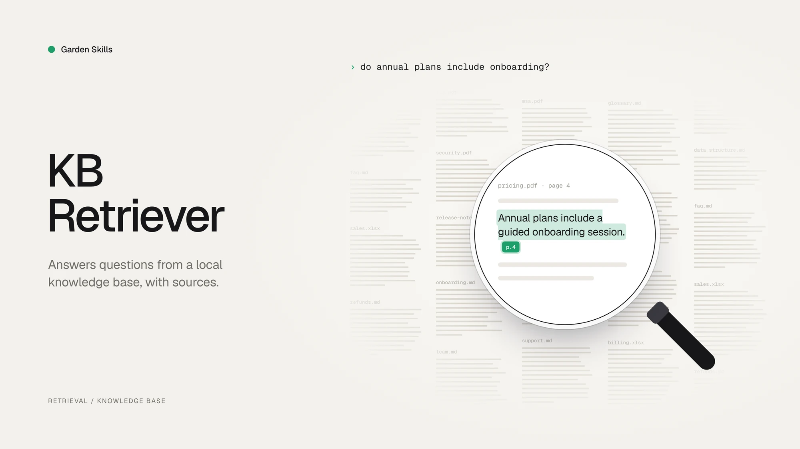

# Kb Retriever Skill — Local Knowledge-Base Retriever

> A skill for AI agents to efficiently answer questions over a **local, multi-format knowledge directory** using hierarchical index navigation and progressive retrieval — without ever loading whole files into context.

[中文文档](./README.zh-CN.md) · [Back to collection root](../../README.md)



## What it does

Point the agent at a local directory full of mixed-format files (Markdown, PDF, Excel, …) and ask questions in natural language. The skill:

1. **Walks a hierarchical index** of `data_structure.md` files to figure out *which* files are likely to contain the answer.
2. **Forces a learn-before-process step** when it hits a PDF or Excel — it must read the corresponding `references/*.md` first and use the recommended tool, instead of blindly reading the whole file.
3. **Retrieves progressively** with `grep` + small windowed reads (offset/limit) instead of dumping entire files into context.
4. **Iterates up to 5 rounds**, narrowing keywords each round until it has enough evidence to answer.

---

## Core features

- ✅ **Multi-format**: Markdown / text, PDF, Excel — extensible per file type.
- ✅ **Hierarchical index**: each directory carries its own `data_structure.md`, forming an index tree the agent navigates.
- ✅ **Progressive retrieval**: grep-first, windowed reads, never whole-file loads — keeps token usage low even on large corpora.
- ✅ **Mandatory learning step**: PDF/Excel processing is gated on reading the right `references/*.md` first.
- ✅ **Bounded iteration**: at most 5 retrieval rounds, with explicit termination conditions.

---

## Skill structure

```
skills/kb-retriever/
├── SKILL.md                            Main skill (frontmatter name: kb-retriever)
├── README.md  /  README.zh-CN.md       This document
├── references/
│   ├── pdf_reading.md                  How to handle PDFs (pdftotext / pdfplumber / pypdf)
│   ├── excel_reading.md                How to read Excel with pandas (nrows, dtype, etc.)
│   └── excel_analysis.md               How to filter / aggregate / derive metrics on Excel
└── scripts/
    └── convert_pdf_to_images.py        Convert PDF pages to images when text extraction fails
```

---

## Setting up your knowledge base

This skill **does not ship a knowledge base** — you bring your own. Two ways to wire it up:

### Default location

Put a `knowledge/` directory at the root of the workspace where you invoke the agent:

```
your-project/
├── .claude/skills/  or  .agents/skills/
│   └── kb-retriever/             ← this skill folder
└── knowledge/                    ← ← ← your knowledge base
    ├── data_structure.md         (root-level index, see template below)
    ├── <domain-1>/
    │   ├── data_structure.md
    │   └── ...
    └── <domain-2>/
        └── ...
```

### Custom location

Tell the agent which path to use in your question, e.g. *"answer from `./docs`"* or *"my knowledge base is at `/data/kb`"*. The skill will use that path instead.

If the default `knowledge/` does not exist and the user hasn't specified a path, the skill will ask rather than guess.

### `data_structure.md` template

Each indexed directory should carry one of these:

```markdown
# [Directory name]

## Purpose
What this directory is for and when it should be searched.

## Files
- file1.pdf — what it contains, time / version range
- file2.xlsx — schema summary, key columns
- subdir/ — what lives in this subdirectory

## Coverage
Time range, version, source, anything else that helps the agent prioritize.
```

---

## How it retrieves

### 1. Hierarchical index navigation

For each directory level the skill reads `data_structure.md`, picks the most relevant child(ren) for the user's question, and recurses — so it doesn't fan out across the whole tree.

### 2. Learn before process (PDF / Excel)

When the candidate set contains a PDF or Excel file, the skill **must** first read the corresponding reference doc:

```
✅ Read references/pdf_reading.md  /  excel_reading.md  /  excel_analysis.md
✅ Understand the recommended tool & flags
✅ Convert / extract the file with that tool
⏭️  Then start retrieving
```

Forbidden:

- ❌ Trying to process a PDF without reading `pdf_reading.md`
- ❌ Trying to process an Excel without reading `excel_reading.md` / `excel_analysis.md`
- ❌ Skipping the conversion step and grepping the raw binary

### 3. Progressive retrieval

- Don't read whole files.
- Use `grep` to locate keywords first.
- Read only the matching window (`limit` ≈ 200–500 lines).
- Iterate up to 5 rounds, refining keywords.

### 4. Per-format tool strategy

| Format | Tool | Notes |
|---|---|---|
| Markdown / text | `grep` + windowed `read_file` | Always offset/limit; never whole-file. |
| PDF | `pdftotext input.pdf output.txt` → `grep` on the text | **Always extract to a file**, never to stdout. Use `-f / -l` for page ranges on huge PDFs. |
| Excel | pandas with `nrows` first to learn schema, then filtered reads | Identify key columns (id / time / category) before querying. |

### 5. Iteration loop

Each round:

1. Generate / update keywords
2. Pick under-explored candidate files
3. Run grep / windowed reads
4. Inspect snippets
5. Decide: enough to answer? → stop. Otherwise iterate.

Stops on either: answer found ✅, or 5 rounds reached ⏱️.

---

## Best practices

### Recommended

1. Always start from `data_structure.md`.
2. Read the matching `references/*.md` *before* touching a PDF or Excel.
3. Retrieve from the most relevant file first; expand only if needed.
4. Use `offset` + `limit` to read precise windows.
5. Extract PDFs to files, then grep — never paste the binary into context.

### Avoid

1. ❌ Reading entire large files in one go.
2. ❌ Processing PDF / Excel without reading the references first.
3. ❌ `pdftotext input.pdf -` (stdout) — eats tokens.
4. ❌ Loading a whole Excel sheet at once.
5. ❌ Blind search across all directories.

---

## FAQ

**Q1: Why force the agent to read `references/*.md` first?**
To make sure the agent uses the right tool with the right flags — otherwise it tends to either dump huge files into context or pick a slow / broken tool.

**Q2: How do I handle a very large PDF?**
Use page-ranged extraction (`pdftotext -f 1 -l 10`), grep the resulting text, then read only the matching pages.

**Q3: Can my knowledge base live anywhere?**
Yes. Just say so in your question: *"answer from `/data/my-kb`"*.

**Q4: How do I improve retrieval accuracy?**
Use specific keywords, narrow down with time / file-name hints, and prefer domain-specific terminology over generic words.

---

## Tool requirements

The skill assumes the agent has access to:

- `grep` — text search
- `read_file` — windowed reads with offset / limit
- `pdftotext` (poppler) or `pdfplumber` — PDF text extraction
- `pandas` — Excel reads & analysis

`scripts/convert_pdf_to_images.py` is provided for the fallback case where text extraction yields nothing useful (scanned PDFs).

---

## License

MIT
