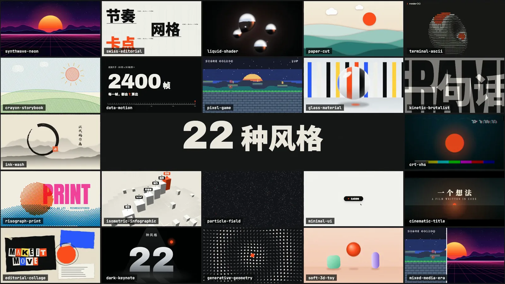

# Motion Showreel Skill

**用代码做「一眼惊艳」的短视频：动效作品集、产品宣传短片、UI 动效、动态排版、Logo 演绎、生成艺术循环、年代回顾，配乐可选、卡点精确到帧。**

[English](./README.md) · [返回集合首页](../../README.zh-CN.md)



<sub>↑ Skill 自己的宣传片里的一帧：22 种风格同时在一个页面里运行，全部由同一个 `render(t)` 驱动。</sub>

---

## 这是什么？

`motion-showreel` 把一句话变成一支做完的短视频（MP4 + 可编辑源码），内容以图形、文字或界面动画为主。Agent 写一个「画面只由时间决定」的网页，逐帧渲染，在同一张时间表上配乐和音效，检查无误后再交付。

适合：

- 动效作品集
- 产品宣传短片、发布预告（只用用户给的事实和截图）
- UI 动效演示：形变链、微交互
- 动态排版、金句卡点
- Logo 演绎、片头、频道 bumper
- 生成艺术循环、数据爆点
- 年代回顾：随段落切换媒介（像素 → 矢量 → 3D……）

常见时长 5–60 秒；没有旁白、纯音乐驱动的片子可以做到 2 分钟左右。不做：口播讲解（用 [`web-video-presentation`](../web-video-presentation)）、网页和原型（用 [`web-design-engineer`](../web-design-engineer)）、写实人物、实拍、剪辑已有视频。

---

## 作品展示

下面每一支都是 Agent 用这个 Skill 根据一句简短的需求做出来的，多数需求只给了风格，加一句「其余你来定」。预览是 4 秒、12 fps 的片段，原片是 1920×1080、30fps、有声。

<table>
<tr>
<td width="50%" valign="top"><br/><strong>Motion Showreel 宣传片</strong> · 80 秒<br/><sub>Skill 自己的宣传片。一个橙色的点每拍换一种媒介重画一遍（水墨、剪纸、孔版印刷、CRT、拼贴、玻璃、黏土……），最后炸成 22 种风格同时运行的一面墙；合成配乐的配器跟着媒介一起换。</sub></td>
<td width="50%" valign="top"><br/><strong>AFTERGLOW</strong> · 19 秒 · <code>synthwave-neon</code><br/><sub>一张虚构专辑的片头。镜头贴地穿过一道道霓虹门，穿过最后一道之后黑半拍，镀铬大字在 drop 上从地平线里弹起来。</sub></td>
</tr>
<tr>
<td width="50%" valign="top"><br/><strong>boink</strong> · 18 秒 · <code>soft-3d-toy</code><br/><sub>一镜到底的连锁反应（对标本田「Cog」广告）。每块多米诺骨牌是一个马林巴音；果冻砸地后，一圈挤压冲击波扫过整个世界，开场那颗小球最后落成字母 i 上的点。</sub></td>
<td width="50%" valign="top"><br/><strong>最后一笔 LAST STROKE</strong> · 30 秒 · 自定义「墨线火柴人」风格<br/><sub>一款虚构小游戏的预告：你画下的每一笔都会成真。主角一笔横穿 40 个敌人，之后是全片唯一一拍完全静音，然后所有敌人炸成墨点，那一笔变成片名。</sub></td>
</tr>
<tr>
<td width="50%" valign="top"><br/><strong>UMBRA 本影</strong> · 27 秒 · <code>cinematic-title</code><br/><sub>一部虚构的日全食电影的片头，2.39:1 黑边。一拍绝对静音之后，最后一颗贝利珠炸成钻石环，片名在月亮的黑盘里显影。钢琴用 Salamander 采样（第 2 档），上面叠第 1 档合成的预告片音效（boom、braam）。</sub></td>
<td width="50%" valign="top"><br/><strong>每支片子交付什么</strong><br/><sub>
<code>out/final.mp4</code> + <code>out/poster.png</code><br/>
<code>brief.md</code>：可以复用的结构化提示词<br/>
<code>index.html</code> / <code>timeline.js</code> / <code>score.mjs</code>：可编辑的源码<br/>
<code>sh build.sh</code>：整片重建，也可以只重渲一段<br/>
<code>qa/</code>：抽帧图、手机尺寸检查、波形图和频谱图<br/>
技术检查结果（全部 PASS）+ 如实记录的审片记录
</sub></td>
</tr>
</table>

---

## 核心理念

- **画面 = 时间的函数**：页面暴露确定性的 `window.render(t)`（不用 `Math.random`、定时器、rAF、CSS 动画），Playwright 逐帧截图，ffmpeg 合成 MP4。运动模糊（`--subframes`）、超采样（`--dpr`）、胶片颗粒（`--grain`）都是渲染参数，不写在页面里。
- **画面和声音共用一张时间表**：`timeline.js` 里写着每个切点、撞击和音效，页面和配乐都从它读取，卡点精确到帧。
- **先找对标，再想三个结构**：动笔前先挑 1–2 个对标作品，写清学什么、不学什么，再写三个候选结构。第一个冒出来的想法往往是这个风格的陈词滥调。
- **风格库是起点，不是选择题**：22 种风格，每种写明不变的规则（质感、配色、字体、运动、镜头语法、声音调色板、原生手法、坑）。可以直接用、改造、混搭，也可以按模板自定义。
- **声音也要先定方向**：brief 里声音和画面同等对待，写清对标、律动、和声、配器、戏剧曲线；再配一份声音的「默认味」清单，免得几支片子听起来像同一首歌。
- **一次确认，然后全力以赴**：唯一的停顿点是风格帧。用户没定风格时，给 3 个拉开差距的方向，每个一张关键帧；确认之后全部自主完成。
- **技术验收和审美判断分开**：尺寸、帧率、时长、帧数、黑帧、响度、真峰值、循环接缝、确定性这些由程序判定，必须全部 PASS。审片记录只是帮用户更快地看片，不能代替用户自己看。
- **放手模式**：用户说「全力以赴」「给我惊喜」时，只守底线和技术管线，风格、结构、手法都交给模型判断。

---

## 工作流

```text
0  环境检查（一次）
1  一次问清 ─────────── 最多 5 个问题，能推断的就不问
2  brief.md ─────────── 对标 → 用途 + 风格 → Reel Read → 节拍网格 + 分镜 + 禁止清单
3  风格帧 ───────────── 🛑 唯一停顿点：已定风格 → 3 张帧；未定风格 → 3 个方向各 1 张
4  制作 ─────────────── timeline → 逐镜头 → 静帧自检 → 确定性检查 → 小样 → 正片
5  声音（可选）──────── 代码合成 / 用户曲子 / 无声
6  验收 ─────────────── 技术检查（必须 PASS）+ 审片（交给用户终审）
7  交付
```

---

## 风格库

22 种风格，分 7 组：图形与排版、界面与产品、复古与屏幕、3D 与材质、生成与抽象、手作、电影感。下面几种是 Skill 自己渲出来的：

<table>
<tr>
<td align="center" width="25%"><br /><sub><code>swiss-editorial</code> 瑞士编辑</sub></td>
<td align="center" width="25%"><br /><sub><code>ink-wash</code> 水墨</sub></td>
<td align="center" width="25%"><br /><sub><code>risograph-print</code> 孔版印刷</sub></td>
<td align="center" width="25%"><br /><sub><code>editorial-collage</code> 杂志拼贴</sub></td>
</tr>
<tr>
<td align="center" width="25%"><br /><sub><code>isometric-infographic</code> 等距信息图</sub></td>
<td align="center" width="25%"><br /><sub><code>liquid-shader</code> 液态着色器</sub></td>
<td align="center" width="25%"><br /><sub><code>data-motion</code> 数据动效</sub></td>
<td align="center" width="25%"><br /><sub><code>generative-geometry</code> 生成几何</sub></td>
</tr>
<tr>
<td align="center" width="25%"><br /><sub><code>pixel-game</code> 像素游戏</sub></td>
<td align="center" width="25%"><br /><sub><code>synthwave-neon</code> 合成波霓虹</sub></td>
<td align="center" width="25%"><br /><sub><code>paper-cut</code> 剪纸</sub></td>
<td align="center" width="25%"><br /><sub><code>minimal-ui</code> 极简界面</sub></td>
</tr>
</table>

<sub>库里还有：<code>kinetic-brutalist</code> · <code>dark-keynote</code> · <code>glass-material</code> · <code>soft-3d-toy</code> · <code>particle-field</code> · <code>crt-vhs</code> · <code>terminal-ascii</code> · <code>crayon-storybook</code> · <code>cinematic-title</code> · <code>mixed-media-era</code>。目录、三方向规则和混搭方法见 <a href="./references/styles/INDEX.md"><code>references/styles/INDEX.md</code></a>。</sub>

---

## 声音

| 档 | 引擎 | 适合 |
|---|---|---|
| 第 1 档 · 内置合成（默认） | `score.mjs`，零依赖、完全确定：鼓与手鼓、贝斯、铺底、拨弦、敲击乐（马林巴 / 钢片琴 / 卡林巴 / 钢鼓）、风琴、人声铺底、FM 钟声、环境底噪（磁带、黑胶、风、雨）、swing / 步进节奏、侧链、bitcrush、磁带抖动 | 电子、界面、复古、抽象、手作、lo-fi |
| 第 2 档 · Tone.js | `score.tone.js`，在无头 Chromium 里离线渲染：采样乐器（Salamander 钢琴，CC BY）、卷积混响、合唱 / 相位 / 失真 | 电影感、高端产品、需要真实乐器和空间感的片子 |
| 用户曲子 | `audio.mjs beats` 测出 BPM、拍点、强拍和 drop（有 librosa 时优先使用），再叠音效 | 已有配乐 |

两档可以叠用：底下是 Tone.js 的音乐，上面叠合成音效，最后统一做母带。所有混音都处理到 −14 LUFS / −1 dBTP。模型听不到声音，所以 `audio.mjs check` 会输出响度、频段平衡和静音段，量出每个声明过的 drop 前有没有「呼吸」，并画出波形图和频谱图给模型看。

---

## 目录结构

```text
skills/motion-showreel/
├── SKILL.md                 工作流 + 底线 + 工具速查
├── README.md / README.zh-CN.md
├── manifest.json
├── references/
│   ├── formats.md           9 种用途（作品集、宣传片、UI 动效、排版卡点、Logo、循环、数据、年代回顾、绿幕合成）
│   ├── styles/              INDEX.md + _template.md + 22 个风格文件
│   ├── craft.md             节奏、运动、转场、镜头、排版、配色、质感、签名时刻、默认味清单
│   ├── sound.md             声音方向、合成 API、Tone.js、戏剧曲线、律动 / 和声词汇、混音、声音默认味
│   ├── stack.md             页面契约、确定性、各技术的坑、字体、多画幅、性能
│   ├── recipes.md           现成写法（遮罩逐字、形变链、粒子组字、无缝循环、WebGL 后期、Canvas 伪 3D……）
│   ├── brief-template.md    每支片子的结构化提示词模板
│   └── review.md            技术检查、审片表、常见问题、交付清单
├── scripts/
│   ├── setup.sh · check-env.mjs · scaffold.sh
│   ├── render.mjs           静帧、拼图、三方向、封面、确定性、小样、正片
│   ├── audio.mjs            build · check · beats · samples · mux
│   ├── inspect.mjs          qa · sheet · phone · strip · frames · motion · loop
│   ├── lib/                 合成器、Tone.js 渲染、FFT、浏览器、项目工具
│   └── test/                回归测试（npm test）
└── assets/starter/          index.html · motion.js · timeline.js · score.mjs · score.tone.js · score.layer.mjs · build.sh
```

---

## 快速开始

先安装 Skill（见[集合首页](../../README.zh-CN.md#安装)），然后在 Skill 目录里跑一次初始化：

```bash
sh scripts/setup.sh        # 安装 Playwright + Chromium + Tone.js，再做环境检查
```

依赖：**Node 18+** 和 **ffmpeg**（需要在 `PATH` 里）。初始化脚本不会替你安装系统软件。

然后直接说：

```text
给我们的发布会做一支 15 秒的动效视频，全力以赴。
给「Garden」做一个 Logo 动画，瑞士编辑风。
用这三张截图做一支 20 秒的产品宣传短片，要配乐。
做一个 6 秒的无缝循环生成艺术，不要声音。
```

Agent 会建好 `<slug>/`，给你看一次风格帧，然后自己完成制作、配乐、检查和交付。之后想重建或微调：

```bash
sh <slug>/build.sh                                   # 按 build.sh 顶部的规格整片重建
node scripts/render.mjs <slug> --start 6 --duration 3 --out out/seg.mp4   # 只重渲一段
```

工具自带回归测试：`cd scripts && npm test`。
