# Motion Showreel Skill

**用代码制作动效视频：从几秒的 Logo 演绎到最长 20 分钟的分章内容，支持配乐、音效、用户口播和 TTS，交付 MP4 与可编辑源码。**

[English](./README.md) · [返回集合首页](../../README.zh-CN.md)

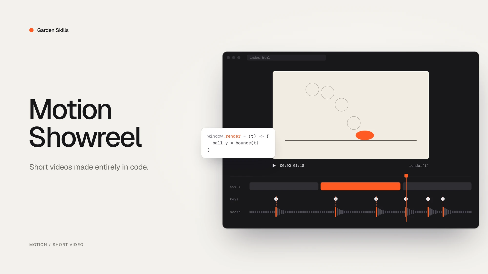

---

## 这是什么？

`motion-showreel` 把想法做成完整视频（MP4 + 可编辑源码），内容以图形、文字或界面动画为主。Agent 先与你确认需求和风格，再写一个「画面只由时间决定」的网页逐帧渲染。画面与声音共用时间表；有口播时先确定真实语音节奏，再制作画面。

适合：

- 动效作品集
- 产品宣传短片、发布预告（只用用户给的事实和截图）
- UI 动效演示：形变链、微交互
- 动态排版、金句卡点
- Logo 演绎、片头、频道 bumper
- 生成艺术循环、数据爆点
- 年代回顾：随段落切换媒介（像素 → 矢量 → 3D……）

短片常见 5–60 秒，也支持最长 **20 分钟**的分章视频，以及根据用户原稿或录音制作的口播讲解。需要点击推进的演示或文章转口播稿，用 [`web-video-presentation`](../web-video-presentation)；网页和原型用 [`web-design-engineer`](../web-design-engineer)。不生成写实人物、不拍摄实景，也不承担一般视频剪辑。

开始前需要明确：**核心主题与内容、时长、横屏或竖屏、BGM 来源、音效来源、口播方式**。BGM 与音效分别选择 AI 合成、用户提供，也可关闭。口播可选无口播、TTS 或用户录音；**使用 TTS 时，口播稿必须由用户提供**，并配置相应服务的 API（支持 Gemini、MiniMax 和自定义适配器）。已有配置可复用。指定时长与真实口播冲突时会先确认，不会自动截断、变速或改稿。

相关资料、受众与平台、风格可选。你已说明具体内容并希望 AI 生成时，Agent 据此制作；内容不足时补问资料或调研，口播稿里的信息会直接使用。真实事实和品牌素材仍需准确。未指定风格时，提供三个方向供你选择。

---

## 作品展示

下面每一支都是 Agent 用这个 Skill 根据一句简短的需求做出来的，多数需求只给了风格，加一句「其余你来定」。预览是 4 秒、12 fps 的片段，原片是 1920×1080、30fps、有声。

<table>
<tr>
<td width="50%" valign="top">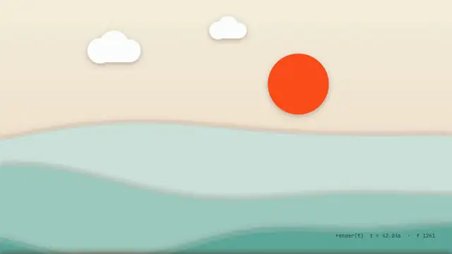<br/><strong>Motion Showreel 宣传片</strong> · 80 秒<br/><sub>Skill 自己的宣传片。一个橙色的点每拍换一种媒介重画一遍（水墨、剪纸、孔版印刷、CRT、拼贴、玻璃、黏土……），最后炸成 22 种风格同时运行的一面墙；合成配乐的配器跟着媒介一起换。</sub></td>
<td width="50%" valign="top">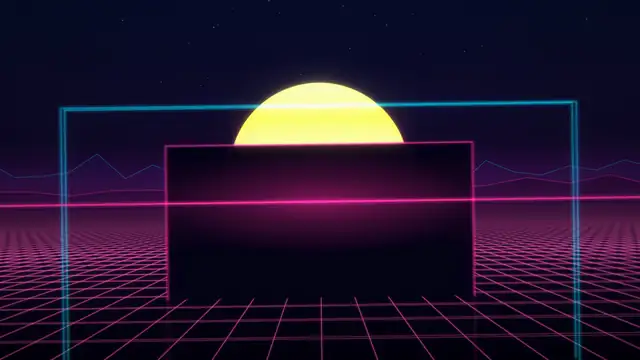<br/><strong>AFTERGLOW</strong> · 19 秒 · <code>synthwave-neon</code><br/><sub>一张虚构专辑的片头。镜头贴地穿过一道道霓虹门，穿过最后一道之后黑半拍，镀铬大字在 drop 上从地平线里弹起来。</sub></td>
</tr>
<tr>
<td width="50%" valign="top">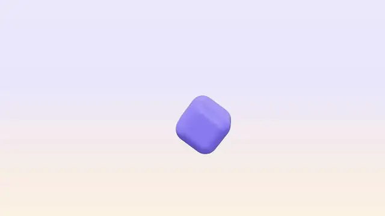<br/><strong>boink</strong> · 18 秒 · <code>soft-3d-toy</code><br/><sub>一镜到底的连锁反应（对标本田「Cog」广告）。每块多米诺骨牌是一个马林巴音；果冻砸地后，一圈挤压冲击波扫过整个世界，开场那颗小球最后落成字母 i 上的点。</sub></td>
<td width="50%" valign="top">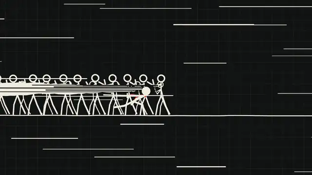<br/><strong>最后一笔 LAST STROKE</strong> · 30 秒 · 自定义「墨线火柴人」风格<br/><sub>一款虚构小游戏的预告：你画下的每一笔都会成真。主角一笔横穿 40 个敌人，之后是全片唯一一拍完全静音，然后所有敌人炸成墨点，那一笔变成片名。</sub></td>
</tr>
<tr>
<td width="50%" valign="top">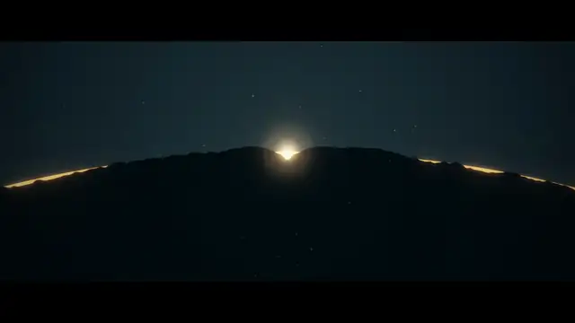<br/><strong>UMBRA 本影</strong> · 27 秒 · <code>cinematic-title</code><br/><sub>一部虚构的日全食电影的片头，2.39:1 黑边。一拍绝对静音之后，最后一颗贝利珠炸成钻石环，片名在月亮的黑盘里显影。钢琴用 Salamander 采样（第 2 档），上面叠第 1 档合成的预告片音效（boom、braam）。</sub></td>
<td width="50%" valign="top"><br/><strong>每支片子交付什么</strong><br/><sub>
实际导出的 MP4（工作区版为 <code>out/editor-&lt;task-id&gt;.mp4</code>）+ <code>out/poster.png</code><br/>
<code>brief.md</code>：可以复用的结构化提示词<br/>
<code>index.html</code> / <code>timeline.js</code> / <code>score.mjs</code>：可编辑的源码<br/>
<code>sh build.sh</code>：整片重建，也可以只重渲一段<br/>
<code>qa/</code>：抽帧图、手机尺寸检查、按镜头的运动报告、文字框景标记图、波形图和频谱图<br/>
技术检查结果（全部 PASS）+ 如实记录的审片记录
</sub></td>
</tr>
</table>

---

## 核心理念

- **画面 = 时间的函数**：页面暴露确定性的 `window.render(t)`（不用 `Math.random`、定时器、rAF、CSS 动画），Playwright 逐帧截图，ffmpeg 合成 MP4。运动模糊（`--subframes`）、超采样（`--dpr`）、胶片颗粒（`--grain`）都是渲染参数，不写在页面里。
- **画面和声音共用一张时间表**：`timeline.js` 里写着每个切点、撞击和音效，页面和配乐都从它读取，卡点精确到帧。
- **先找对标，再想三个结构**：动笔前先挑 1–2 个对标作品，写清学什么、不学什么，再写三个候选结构。第一个冒出来的想法往往是这个风格的陈词滥调。参考视频可以量：`inspect.mjs grid` 找出剪点和它们落的节拍网格，`heat` 看每段里哪里在动。
- **风格库是起点，不是选择题**：43 种风格，每种写明不变的规则（质感、配色、字体、运动、镜头语法、声音调色板、原生手法、坑）。每种还列了 8–12 个辨识信号（按主题挑 2–3 个），并把这个风格最俗的版本直接写出来，选了合成波也不会每次都是网格加日落。可以直接用、改造、混搭，也可以按模板自定义。
- **声音也要先定方向**：brief 里声音和画面同等对待，写清对标、律动、和声、配器、戏剧曲线；再配一份声音的「默认味」清单，免得几支片子听起来像同一首歌。
- **想看过程，就提前打开。** 初始反馈中表达「边做边看」「实时进度」时，Agent 会打开制作进度页，逐阶段展示风格帧、口播样例、镜头和混音；完成后在同一页预览确认。只发布已自查的阶段成果，沿用原制作和验收标准，见 [`references/progress.md`](./references/progress.md)。
- **需求、风格与最终预览分别确认**：先补齐必填信息并确认需求，再确认风格帧；制作完成后主动打开工作区，预览通过再导出 MP4。用户没定风格时给 3 个拉开差距的方向；「给我惊喜」保留创意自由，不代表替用户默认制作规格。
- **口播优先**：TTS 使用用户原稿，或导入用户录音与真实句段时间戳；画面跟随讲述，BGM 和音效在说话期间收敛。长片按章构建并保留缓存，失败后可继续。
- **连续画面**：分镜记录对象的前后状态和空间承接，镜头可跨句发展。关键词事件使用真实词时间或人工锚点；带声音预览支持拖动和逐帧检查。依赖运动的方向，随风格帧一起确认连续小样。
- **技术验收和审美判断分开**：尺寸、帧率、时长、帧数、黑帧、响度、真峰值、循环接缝、确定性这些由程序判定，必须全部 PASS。旁边还有量出来的审片材料，不挡构建：按镜头的运动（含突然的跳变和单帧闪），以及文字框景（字被画面切掉、叠字、落进安全区、字太小）。审片记录只是帮用户更快地看片，不能代替用户自己看。
- **放手模式**：用户说「全力以赴」「给我惊喜」时，只守底线和技术管线，风格、结构、手法都交给模型判断。

---

## 工作流

```text
0  环境检查（一次）
1  需求确认 ─────────── 补齐必要信息、汇总要求 → 🛑 等你确认
2  brief.md ─────────── 对标 → 用途 + 风格 → 分镜 + 声音计划
3  风格帧 ───────────── 已定风格：3 张帧；未定风格：3 个方向各 1 张 → 🛑 等你确认
4  制作 ─────────────── 有口播先确定真实音频时间轴 → 逐镜头 → 网页自检
5  配乐与混音 ───────── BGM / 音效独立来源；人声优先
6  工作区预览 ───────── 主动打开工作区，修改后复看 → 🛑 等你确认导出
7  导出与验收 ───────── 合成 MP4 → 技术检查（必须 PASS）+ 成片复核
8  交付
```

默认工作区与导出确认见 [`references/editor.md`](./references/editor.md)。口播与独立轨混音见 [`references/narration.md`](./references/narration.md)；超过 2 分钟的章节构建、缓存与审片见 [`references/long-form.md`](./references/long-form.md)。旧短片的全部风格、两档配乐、卡点、循环和渲染参数继续保留。

---

## 风格库

43 种风格，分 8 组：图形与排版、界面与产品、复古与屏幕、3D 与材质、生成与抽象、插画与漫画、手作、电影感。下面是代码渲染的风格样片，最后新增的三段均为 4 秒、20 fps 的无缝循环动图：

<table>
<tr>
<td align="center" width="25%">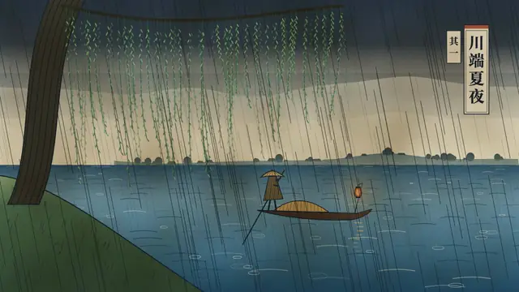<br /><sub><code>ukiyo-e</code> 浮世绘木版</sub></td>
<td align="center" width="25%">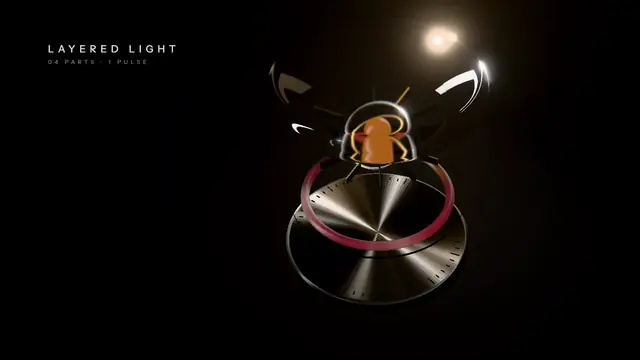<br /><sub><code>glass-material</code> 玻璃金属材质</sub></td>
<td align="center" width="25%">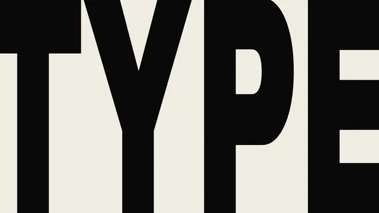<br /><sub><code>kinetic-brutalist</code> 粗野动态排版</sub></td>
<td align="center" width="25%">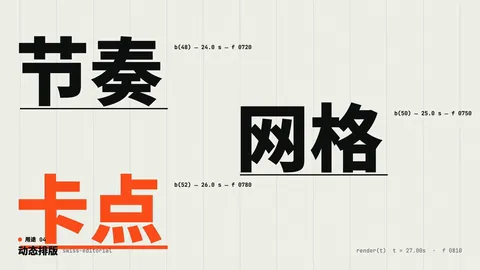<br /><sub><code>swiss-editorial</code> 瑞士编辑</sub></td>
</tr>
<tr>
<td align="center" width="25%">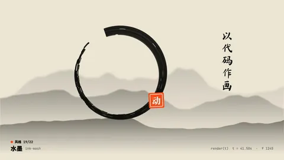<br /><sub><code>ink-wash</code> 水墨</sub></td>
<td align="center" width="25%">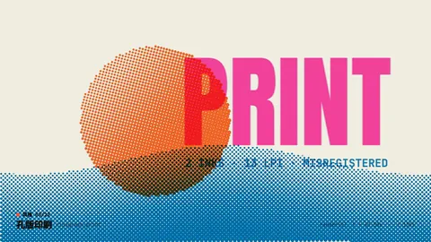<br /><sub><code>risograph-print</code> 孔版印刷</sub></td>
<td align="center" width="25%">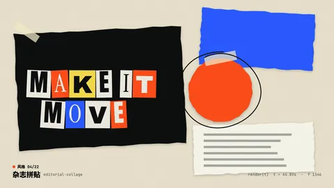<br /><sub><code>editorial-collage</code> 杂志拼贴</sub></td>
<td align="center" width="25%">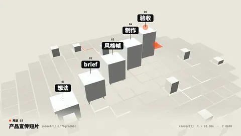<br /><sub><code>isometric-infographic</code> 等距信息图</sub></td>
</tr>
<tr>
<td align="center" width="25%">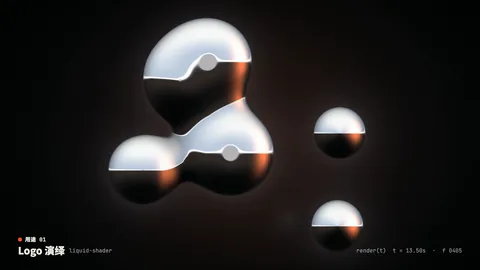<br /><sub><code>liquid-shader</code> 液态着色器</sub></td>
<td align="center" width="25%">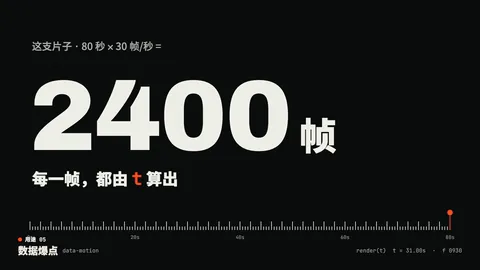<br /><sub><code>data-motion</code> 数据动效</sub></td>
<td align="center" width="25%">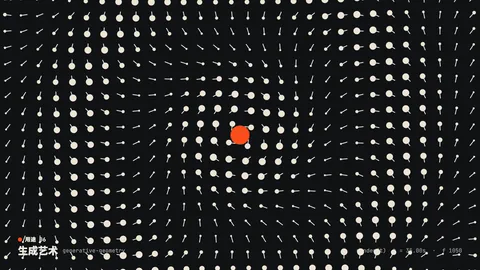<br /><sub><code>generative-geometry</code> 生成几何</sub></td>
<td align="center" width="25%">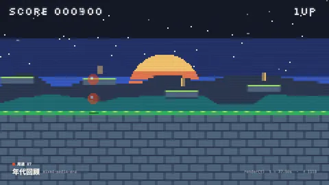<br /><sub><code>pixel-game</code> 像素游戏</sub></td>
</tr>
<tr>
<td align="center" width="25%">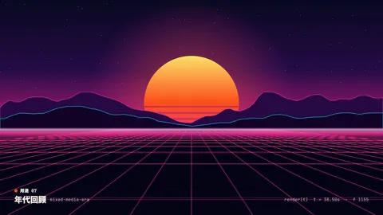<br /><sub><code>synthwave-neon</code> 合成波霓虹</sub></td>
<td align="center" width="25%">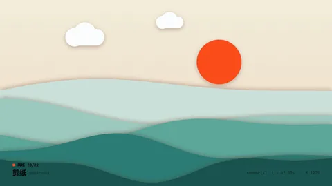<br /><sub><code>paper-cut</code> 剪纸</sub></td>
<td align="center" width="25%">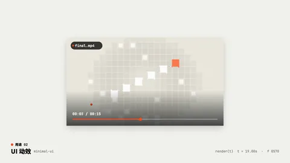<br /><sub><code>minimal-ui</code> 极简界面</sub></td>
<td align="center" width="25%">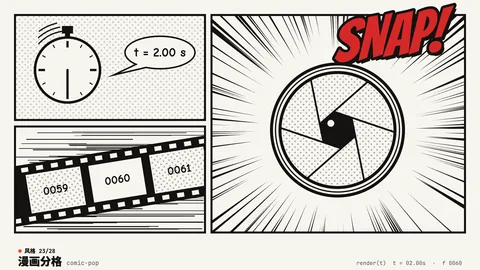<br /><sub><code>comic-pop</code> 漫画分格</sub></td>
</tr>
<tr>
<td align="center" width="25%">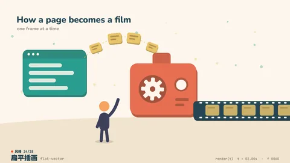<br /><sub><code>flat-vector</code> 扁平插画</sub></td>
<td align="center" width="25%">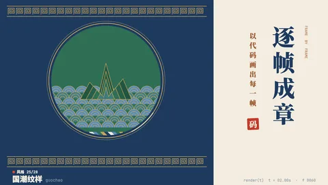<br /><sub><code>guochao</code> 国潮纹样</sub></td>
<td align="center" width="25%">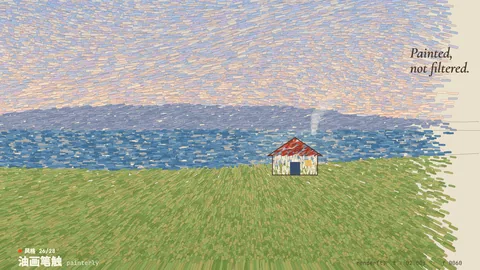<br /><sub><code>painterly</code> 油画笔触</sub></td>
<td align="center" width="25%">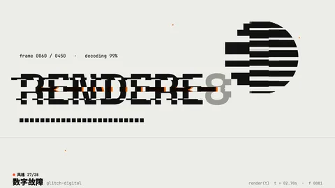<br /><sub><code>glitch-digital</code> 数字故障</sub></td>
</tr>
<tr>
<td align="center" width="25%">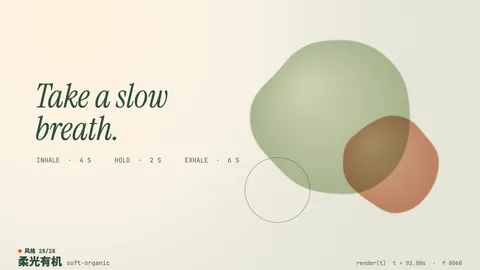<br /><sub><code>soft-organic</code> 柔光有机</sub></td>
<td align="center" width="25%">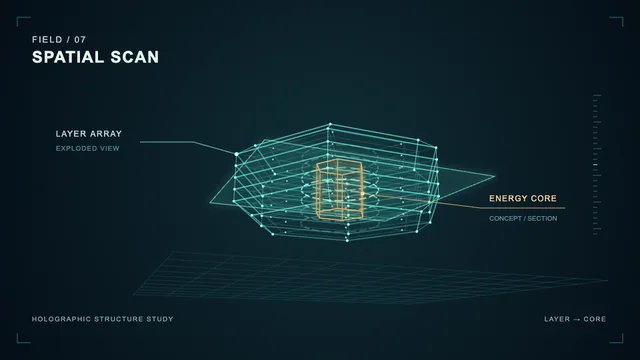<br /><sub><code>hologram-hud</code> 全息空间界面</sub></td>
<td align="center" width="25%">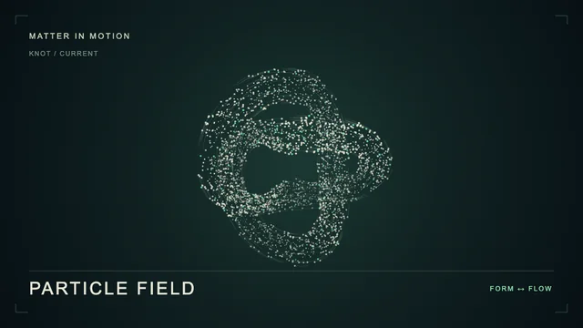<br /><sub><code>particle-field</code> 粒子场</sub></td>
<td align="center" width="25%">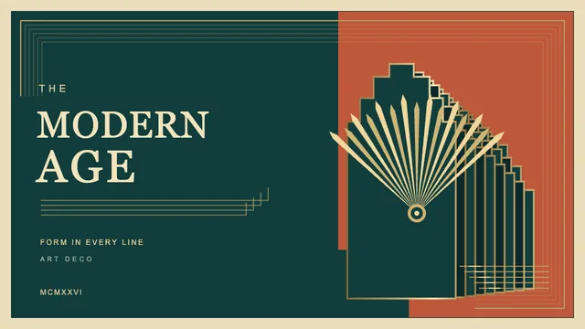<br /><sub><code>art-deco</code> 装饰艺术</sub></td>
</tr>
</table>

<sub>库里还有：<code>dark-keynote</code> · <code>soft-3d-toy</code> · <code>crt-vhs</code> · <code>terminal-ascii</code> · <code>crayon-storybook</code> · <code>copperplate-engraving</code> · <code>cinematic-title</code> · <code>mixed-media-era</code>。目录、三方向规则和混搭方法见 <a href="./references/styles/INDEX.md"><code>references/styles/INDEX.md</code></a>。</sub>

其他风格规则：[装饰艺术](./references/styles/art-deco.md)、[一笔线描](./references/styles/one-line.md)、[工程蓝图](./references/styles/blueprint.md)、[全息空间界面](./references/styles/hologram-hud.md)、[彩色玻璃镶嵌](./references/styles/stained-glass.md)、[移轴微缩](./references/styles/tilt-shift-miniature.md)、[像素立体场景](./references/styles/pixel-diorama.md)、[80 年代赛璐璐动画](./references/styles/cel-anime-80s.md)、[橡皮管动画](./references/styles/rubber-hose.md)、[透光皮影](./references/styles/shadow-puppet.md)。沿用同一模板，写明材质、运动规则和可选技术方向。

也可选择[白板手绘解说](./references/styles/whiteboard-explainer.md)、[数学／概念形变](./references/styles/concept-morph.md)和[泥金手抄本](./references/styles/illuminated-manuscript.md)。

---

## 声音

| 档 | 引擎 | 适合 |
|---|---|---|
| 第 1 档 · 内置合成（默认） | `score.mjs`，零依赖、完全确定：鼓与手鼓、贝斯、铺底、拨弦、敲击乐（马林巴 / 钢片琴 / 卡林巴 / 钢鼓）、风琴、人声铺底、FM 钟声、环境底噪（磁带、黑胶、风、雨）、swing / 步进节奏、侧链、bitcrush、磁带抖动 | 电子、界面、复古、抽象、手作、lo-fi |
| 第 2 档 · Tone.js | `score.tone.js`，在无头 Chromium 里离线渲染：采样乐器（Salamander 钢琴，CC BY）、卷积混响、合唱 / 相位 / 失真 | 电影感、高端产品、需要真实乐器和空间感的片子 |
| 用户曲子 | `audio.mjs beats` 测出 BPM、拍点、强拍和 drop（有 librosa 时优先使用），再叠音效 | 已有配乐 |

两档可以叠用：底下是 Tone.js 的音乐，上面叠合成音效，最后统一做母带。所有混音都处理到 −14 LUFS / −1 dBTP。模型听不到声音，所以 `audio.mjs check` 会输出响度、频段平衡和静音段，量出每个声明过的 drop 前有没有「呼吸」，并画出波形图和频谱图给模型看。

---

## 目录结构

```text
skills/motion-showreel/
├── SKILL.md                 工作流 + 底线 + 工具速查
├── README.md / README.zh-CN.md
├── manifest.json
├── references/
│   ├── formats.md           用途（含口播讲解与分章长片）
│   ├── styles/              INDEX.md + _template.md + 40 个风格文件
│   ├── craft.md             节奏、运动、转场、镜头、排版、配色、质感、签名时刻、默认味清单
│   ├── sound.md             声音方向、合成 API、Tone.js、戏剧曲线、律动 / 和声词汇、混音、声音默认味
│   ├── narration.md         用户原稿 TTS、录音时间戳、关键词事件与人声优先混音
│   ├── long-form.md         最长 20 分钟、章节清单、缓存和断点重建
│   ├── stack.md             页面契约、确定性、各技术的坑、字体、多画幅、性能
│   ├── recipes.md           现成写法（遮罩逐字、形变链、粒子组字、无缝循环、WebGL 后期、Canvas 伪 3D……）
│   ├── brief-template.md    每支片子的结构化提示词模板
│   └── review.md            技术检查、审片表、独立审片、常见问题、交付清单
├── scripts/
│   ├── setup.sh · check-env.mjs · scaffold.sh
│   ├── render.mjs           静帧、拼图、三方向、封面、确定性、文字框景、小样、正片
│   ├── audio.mjs            build · check · beats · samples · mux
│   ├── narration.mjs        tts · import · mix · check
│   ├── progress.mjs         按需发布制作阶段、图片/音频成果与稳定预览
│   ├── editor.mjs           默认审片工作区、分轨编辑、保存、确认后导出
│   ├── preview.mjs          轻量调试：带声音播放、拖动、逐帧与预览倍速
│   ├── build-long.mjs       持久章节缓存、失败重试、拼接与验收
│   ├── inspect.mjs          qa · sheet · phone · strip · frames · motion · loop · grid · heat
│   ├── lib/                 合成器、Tone.js 渲染、FFT、浏览器、项目工具、帧分析、文字钩子
│   └── test/                回归测试（npm test）
└── assets/starter/          页面、motion/timeline/narration 工具、预览控件、配乐与 build.sh
```

---

## 快速开始

先安装 Skill（见[集合首页](../../README.zh-CN.md#安装)），然后在 Skill 目录里跑一次初始化：

```bash
sh scripts/setup.sh        # 安装 Playwright + Chromium + Tone.js，再做环境检查
```

依赖：**Node 18+** 和 **ffmpeg**（需要在 `PATH` 里）。初始化脚本不会替你安装系统软件。

然后直接说：

```text
给我们的发布会做一支 15 秒的动效视频，全力以赴。
给「Garden」做一个 Logo 动画，瑞士编辑风。
用这三张截图做一支 20 秒的产品宣传短片，要配乐。
做一个 6 秒的无缝循环生成艺术，不要声音。
```

Agent 会先补问缺失项并停下来确认，再建好 `<slug>/`、给你看风格帧；风格确认后自主完成画面和配乐，再默认打开剪辑工作区让你预览；你点击导出或确认当前版本可以导出后，才生成 MP4、验收和交付。无声片、循环片也先预览，长片先逐章预览。上面的简短需求可直接发起，但缺失的时长、画幅、BGM/音效来源和口播方式不会被静默填成默认值。之后想重建或微调：

```bash
node scripts/editor.mjs <slug> --size 1920x1080 --fps 30   # 默认先打开工作区，预览通过后点击导出
sh <slug>/build.sh                                   # 用户确认后重建原版，不自动读取工作区音轨编辑
node scripts/preview.mjs <slug> --size 1920x1080 --fps 30   # 轻量调试预览
node scripts/render.mjs <slug> --start 6 --duration 3 --out out/seg.mp4   # 只重渲一段
node scripts/build-long.mjs <slug>/chapters.json       # 长片按章构建，再次运行复用有效缓存
```

工具自带回归测试：`cd scripts && npm test`。
