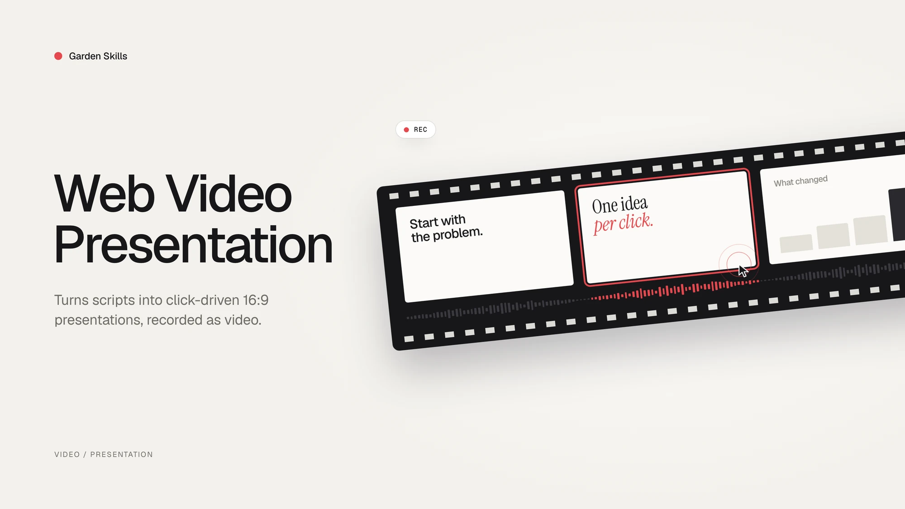

# Web Video Presentation Skill

**A method-driven agent skill for turning scripts and articles into click-driven 16:9 web presentations that can be screen-recorded as cinematic videos.**

[中文文档](./README.zh-CN.md) · [Back to collection root](../../README.md)



---

## What Is This?

`web-video-presentation` helps an agent build a Vite + React + TypeScript presentation that behaves like a video production surface rather than a slide deck. Each click advances one narration beat, each step owns the whole 1920×1080 stage, and the progress UI stays hidden unless hovered so the output is clean for screen recording.

It is designed for:

- Turning a written article into a Bilibili / YouTube / video-channel narration script
- Turning an existing voiceover script into a cinematic web presentation
- Building product demos, tutorials, keynote-style explainers, and visual talks
- Creating “dynamic PPT, but not PPT” experiences with strong motion and pacing
- Optionally synthesizing narration audio after the visual outline is approved

The skill is primarily a **methodology and collaboration workflow**. The scaffold supplies reusable tokens, stage primitives, themes, and examples, but each project should still choose a visual language that fits the topic.

---

## Core Ideas

- **Fixed 16:9 stage** — content is authored in a stable 1920×1080 coordinate system and scaled to the viewport.
- **One global step cursor** — click or keyboard advances `(chapter, step)`, with the cursor persisted locally.
- **One step, one idea** — every beat gets a focused full-screen scene instead of accumulating slide bullets.
- **Script beats drive structure** — narration rhythm maps directly to visual steps.
- **Hidden chrome** — progress controls are hover-only, keeping recordings clean.
- **Motion first** — each scene needs a moving visual anchor; static paragraphs are treated as a smell.
- **Theme tokens** — visual decisions flow through semantic tokens so themes can change the whole feel.
- **Pluggable TTS** — provider-agnostic audio runner ships **two built-in providers** (MiniMax `mmx-cli` and OpenAI TTS via curl); swap to ElevenLabs / edge-tts / Azure / Google Cloud / macOS `say` / any self-hosted TTS by dropping a single shell file into `tts-providers/`.
- **Hard checkpoints** — the agent pauses after script/theme alignment, after outline approval, and before optional audio synthesis.

---

## Workflow

```text
Phase 1.1  Identify input
Phase 1.2  Article -> narration script
   |
Checkpoint A1  Script, theme, and rough asset plan
   |
Phase 1.3  Script + article -> outline.md
   |
Checkpoint A2  Outline approval + development mode
   |
Phase 2    Build the Vite / React / TS presentation
   |
Checkpoint B   Ask whether to synthesize audio
   |
Phase 3    Optional audio synthesis
Phase 4    Recording and post-production
```

The checkpoints are part of the skill contract: the agent should not silently rush from raw article to finished code. Theme choice influences motion design, and outline approval keeps chapter pacing from drifting.

---

## What It Ships

```text
skills/web-video-presentation/
├── SKILL.md
├── README.md / README.zh-CN.md
├── references/
│   ├── PRINCIPLES.md
│   ├── CHAPTER-CRAFT.md
│   ├── OUTLINE-FORMAT.md
│   ├── SCRIPT-STYLE.md
│   ├── THEMES.md
│   ├── AUDIO.md
│   └── RECORDING.md
├── scripts/
│   └── scaffold.sh
├── templates/
│   ├── index.html
│   ├── vite.config.ts
│   ├── scripts/
│   │   ├── extract-narrations.ts
│   │   ├── synthesize-audio.sh       # provider-agnostic runner
│   │   └── tts-providers/            # 1 file = 1 TTS backend
│   │       ├── README.md             # contract + ready-to-paste ElevenLabs / edge-tts / Azure / Google / say snippets
│   │       ├── minimax.sh            # default — uses mmx-cli
│   │       └── openai.sh             # built-in — uses OPENAI_API_KEY via curl
│   └── src/
└── themes/                    # 23 themes, each with its own signature
    ├── midnight-press/
    ├── warm-keynote/
    ├── newsroom/
    ├── bauhaus-bold/
    └── ...                     # full list in references/THEMES.md
```

---

## Quick Start

Copy the skill into the directory your agent scans, then ask it to turn a script or article into a web-video presentation.

To scaffold manually from inside a project:

```bash
bash skills/web-video-presentation/scripts/scaffold.sh ./presentation --theme=paper-press
```

List available themes:

```bash
bash skills/web-video-presentation/scripts/scaffold.sh --list-themes
```

The generated `presentation/` project is a normal Vite + React + TypeScript app. Run it like any other Vite project, then record the 16:9 stage with your screen recorder.

---

## Theme Gallery

The skill ships **23 themes**, each with its own design DNA — not a simple color swap. Browse the gallery below by canvas tone, pick one that fits the topic, or use any tile as a starting point for a derived theme. Click any preview to open the full-size 1920×1080 frame.

> Frames are real 16:9 stages rendered by the live demo gallery at [`demo/web-video-presentation-demo`](../../demo/web-video-presentation-demo/).

### Dark · 8 themes

> Cinematic dark canvases — for focus, drama, and high-contrast storytelling.

<table>
<tr>
<td align="center" width="50%">
<a href="https://cdn.jsdelivr.net/gh/ConardLi/assets@main/imgs/web-video/midnight-press.webp"></a>
<br /><strong><code>midnight-press</code></strong>
<br /><sub>Cinematic editorial dark · warm espresso + hot orange</sub>
<br /><sub><b>Best for</b> · developer tutorials · AI &amp; tool reviews · technical deep dives</sub>
</td>
<td align="center" width="50%">
<a href="https://cdn.jsdelivr.net/gh/ConardLi/assets@main/imgs/web-video/dark-botanical.webp"></a>
<br /><strong><code>dark-botanical</code></strong>
<br /><sub>Premium editorial dark · terracotta / blush / gold glow</sub>
<br /><sub><b>Best for</b> · brand films · fashion &amp; beauty · premium product launches</sub>
</td>
</tr>
<tr>
<td align="center" width="50%">
<a href="https://cdn.jsdelivr.net/gh/ConardLi/assets@main/imgs/web-video/chalk-garden.webp"></a>
<br /><strong><code>chalk-garden</code></strong>
<br /><sub>Slate chalkboard · handwritten Patrick Hand + chalk-yellow</sub>
<br /><sub><b>Best for</b> · explainers · classroom teaching · beginner-friendly walk-throughs</sub>
</td>
<td align="center" width="50%">
<a href="https://cdn.jsdelivr.net/gh/ConardLi/assets@main/imgs/web-video/blueprint.webp"></a>
<br /><strong><code>blueprint</code></strong>
<br /><sub>Drafting board · deep navy + cyan + 60 px grid</sub>
<br /><sub><b>Best for</b> · tech architecture · system breakdowns · API / SDK intros</sub>
</td>
</tr>
<tr>
<td align="center" width="50%">
<a href="https://cdn.jsdelivr.net/gh/ConardLi/assets@main/imgs/web-video/terminal-green.webp"></a>
<br /><strong><code>terminal-green</code></strong>
<br /><sub>80s phosphor CRT · mono-only + scanlines</sub>
<br /><sub><b>Best for</b> · CLI tutorials · hacker / security topics · retro-tech homages</sub>
</td>
<td align="center" width="50%">
<a href="https://cdn.jsdelivr.net/gh/ConardLi/assets@main/imgs/web-video/neon-cyber.webp"></a>
<br /><strong><code>neon-cyber</code></strong>
<br /><sub>Cyberpunk future · cyan + magenta double-neon</sub>
<br /><sub><b>Best for</b> · AI / LLM reviews · web3 &amp; security · futuristic / cyberpunk topics</sub>
</td>
</tr>
<tr>
<td align="center" width="50%">
<a href="https://cdn.jsdelivr.net/gh/ConardLi/assets@main/imgs/web-video/bold-signal.webp"></a>
<br /><strong><code>bold-signal</code></strong>
<br /><sub>Hero pitch deck · dark gradient + orange focal card</sub>
<br /><sub><b>Best for</b> · pitch decks · product launches · brand keynote opens</sub>
</td>
<td align="center" width="50%">
<a href="https://cdn.jsdelivr.net/gh/ConardLi/assets@main/imgs/web-video/creative-voltage.webp"></a>
<br /><strong><code>creative-voltage</code></strong>
<br /><sub>Saturated electric blue + neon yellow halftone</sub>
<br /><sub><b>Best for</b> · design week · studio showcases · type / visual-culture talks</sub>
</td>
</tr>
</table>

### Light · 15 themes

> Bright editorial canvases — for clarity, restraint, and the warmth of printed paper.

<table>
<tr>
<td align="center" width="50%">
<a href="https://cdn.jsdelivr.net/gh/ConardLi/assets@main/imgs/web-video/paper-press.webp"></a>
<br /><strong><code>paper-press</code></strong>
<br /><sub>Editorial paper · warm cream + hot orange</sub>
<br /><sub><b>Best for</b> · magazine pieces · lifestyle · everyday tool reviews</sub>
</td>
<td align="center" width="50%">
<a href="https://cdn.jsdelivr.net/gh/ConardLi/assets@main/imgs/web-video/newsroom.webp"></a>
<br /><strong><code>newsroom</code></strong>
<br /><sub>NYT broadsheet · newsprint cream + banner red</sub>
<br /><sub><b>Best for</b> · documentary reporting · deep reviews · current-affairs commentary</sub>
</td>
</tr>
<tr>
<td align="center" width="50%">
<a href="https://cdn.jsdelivr.net/gh/ConardLi/assets@main/imgs/web-video/monochrome-print.webp"></a>
<br /><strong><code>monochrome-print</code></strong>
<br /><sub>Refined Monocle / Wallpaper print restraint</sub>
<br /><sub><b>Best for</b> · long-read adaptations · academic / opinion · arts criticism</sub>
</td>
<td align="center" width="50%">
<a href="https://cdn.jsdelivr.net/gh/ConardLi/assets@main/imgs/web-video/vintage-editorial.webp"></a>
<br /><strong><code>vintage-editorial</code></strong>
<br /><sub>Witty Fraunces + geometric overlay (circle / line / dot)</sub>
<br /><sub><b>Best for</b> · personal essays · culture columns · type / design talks</sub>
</td>
</tr>
<tr>
<td align="center" width="50%">
<a href="https://cdn.jsdelivr.net/gh/ConardLi/assets@main/imgs/web-video/sunset-zine.webp"></a>
<br /><strong><code>sunset-zine</code></strong>
<br /><sub>Risograph zine · peach + magenta + dashed cut lines</sub>
<br /><sub><b>Best for</b> · lifestyle vlogs · creative shares · short-video / zine-style</sub>
</td>
<td align="center" width="50%">
<a href="https://cdn.jsdelivr.net/gh/ConardLi/assets@main/imgs/web-video/pastel-dream.webp"></a>
<br /><strong><code>pastel-dream</code></strong>
<br /><sub>Soft pastel + sage + right-edge pill ribbon</sub>
<br /><sub><b>Best for</b> · product onboarding · friendly tutorials · wellness &amp; parenting</sub>
</td>
</tr>
<tr>
<td align="center" width="50%">
<a href="https://cdn.jsdelivr.net/gh/ConardLi/assets@main/imgs/web-video/warm-keynote.webp"></a>
<br /><strong><code>warm-keynote</code></strong>
<br /><sub>Modern SaaS keynote · glass slab + teal + warm grid</sub>
<br /><sub><b>Best for</b> · SaaS keynotes · B2B launches · team-facing roll-ups</sub>
</td>
<td align="center" width="50%">
<a href="https://cdn.jsdelivr.net/gh/ConardLi/assets@main/imgs/web-video/electric-studio.webp"></a>
<br /><strong><code>electric-studio</code></strong>
<br /><sub>Corporate clarity · crisp white + electric-blue base bar</sub>
<br /><sub><b>Best for</b> · B2B product talks · investor decks · quarterly updates</sub>
</td>
</tr>
<tr>
<td align="center" width="50%">
<a href="https://cdn.jsdelivr.net/gh/ConardLi/assets@main/imgs/web-video/bauhaus-bold.webp"></a>
<br /><strong><code>bauhaus-bold</code></strong>
<br /><sub>Manifesto modernist · 0 radius + 4 px thick frame</sub>
<br /><sub><b>Best for</b> · product launches · manifestos · brand statements</sub>
</td>
<td align="center" width="50%">
<a href="https://cdn.jsdelivr.net/gh/ConardLi/assets@main/imgs/web-video/swiss-ikb.webp"></a>
<br /><strong><code>swiss-ikb</code></strong>
<br /><sub>Extra-light 200 Helvetica + IKB + 1 px hairline grid</sub>
<br /><sub><b>Best for</b> · AI / tech launches · year-in-review data · info-graphics</sub>
</td>
</tr>
<tr>
<td align="center" width="50%">
<a href="https://cdn.jsdelivr.net/gh/ConardLi/assets@main/imgs/web-video/dune.webp"></a>
<br /><strong><code>dune</code></strong>
<br /><sub>Charcoal + sand · near-zero accent (architecture brochure)</sub>
<br /><sub><b>Best for</b> · architecture &amp; interior · art exhibitions · premium brand books</sub>
</td>
<td align="center" width="50%">
<a href="https://cdn.jsdelivr.net/gh/ConardLi/assets@main/imgs/web-video/indigo-porcelain.webp"></a>
<br /><strong><code>indigo-porcelain</code></strong>
<br /><sub>Indigo <em>is</em> the ink (not an accent) + porcelain white</sub>
<br /><sub><b>Best for</b> · academic research · AI / data deep dives · serious tech briefings</sub>
</td>
</tr>
<tr>
<td align="center" width="50%">
<a href="https://cdn.jsdelivr.net/gh/ConardLi/assets@main/imgs/web-video/forest-ink.webp"></a>
<br /><strong><code>forest-ink</code></strong>
<br /><sub>Forest green <em>is</em> the ink + ivory (vintage National Geographic)</sub>
<br /><sub><b>Best for</b> · nature &amp; sustainability · documentary non-fiction · slow living</sub>
</td>
<td align="center" width="50%">
<a href="https://cdn.jsdelivr.net/gh/ConardLi/assets@main/imgs/web-video/kraft-paper.webp"></a>
<br /><strong><code>kraft-paper</code></strong>
<br /><sub>Deep brown <em>is</em> the ink + kraft beige + copper accent</sub>
<br /><sub><b>Best for</b> · book reviews · history &amp; nostalgia · craft &amp; food storytelling</sub>
</td>
</tr>
<tr>
<td align="center" width="50%">
<a href="https://cdn.jsdelivr.net/gh/ConardLi/assets@main/imgs/web-video/split-canvas.webp"></a>
<br /><strong><code>split-canvas</code></strong>
<br /><sub>Dual-tone · peach left + lavender right</sub>
<br /><sub><b>Best for</b> · A/B comparisons · dialogue stories · concept-contrast explainers</sub>
</td>
<td align="center" width="50%" valign="middle">
<br />
<strong>+ derive your own</strong>
<br /><sub>See <a href="./references/THEMES.md">THEMES.md</a> for the token contract,<br />theme signatures, and Swiss yellow / green / orange variants.</sub>
<br /><br />
</td>
</tr>
</table>

---

## Reference Map

- [PRINCIPLES.md](./references/PRINCIPLES.md) — core rules for video-like web presentations
- [CHAPTER-CRAFT.md](./references/CHAPTER-CRAFT.md) — chapter implementation rules and visual checklist
- [OUTLINE-FORMAT.md](./references/OUTLINE-FORMAT.md) — required outline structure
- [SCRIPT-STYLE.md](./references/SCRIPT-STYLE.md) — article-to-narration rewrite guidance
- [PATTERNS.md](./references/PATTERNS.md) — optional visual primitive recipes
- [AUDIO.md](./references/AUDIO.md) — optional narration synthesis workflow (provider-agnostic)
- [tts-providers/README.md](./templates/scripts/tts-providers/README.md) — TTS provider contract + 2 built-ins (minimax / openai) + ready-to-paste snippets for ElevenLabs / edge-tts / Azure / Google Cloud / macOS say
- [RECORDING.md](./references/RECORDING.md) — screen recording and post-production notes

